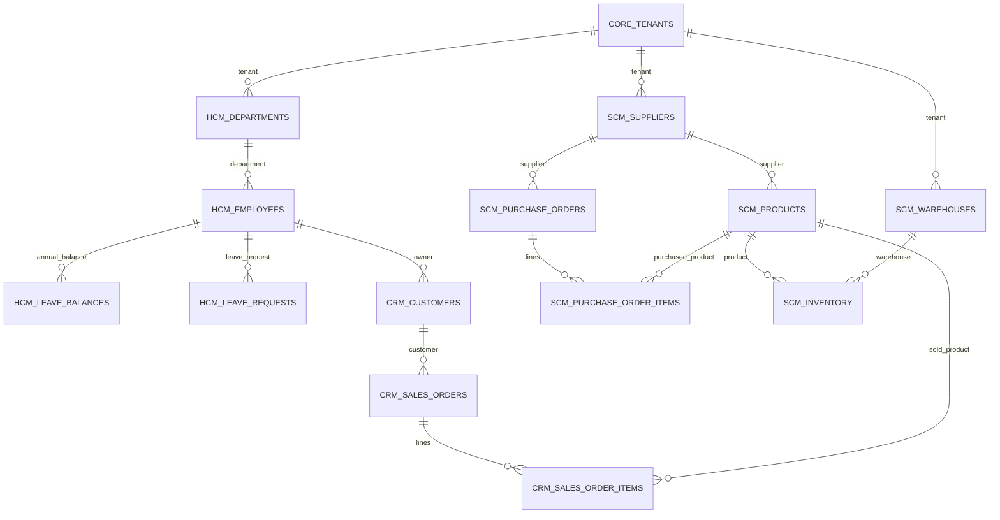

# M02 企业样例数据字典

本文对应初始 schema 版本 1。结构以 `infra/postgres/init/10-schema.sql` 为准，文件格式与额外业务校验以 `src/enterprise_ai/data.py` 为准，查询以 `src/enterprise_ai/queries.py` 为准。[第 2 课](tutorials/02-enterprise-data.md)提供完整操作和验收步骤。

本批为两个组织的合成数据，固定 `as_of=2026-10-15`。姓名、邮箱、金额、年假规则、交期等均用于学习，不能作为真实企业制度。数据集有 **14 张业务表**；另外 3 张内部控制表不在数据集 JSON 的 `tables` 内。

## 1. 统一约定

| 约定 | 含义 |
|---|---|
| `tenant_id` | 租户编号，数据集中为 1 或 2 |
| `id` | 业务实体的租户内编号，不是全库唯一编号 |
| PK | 主键；复合主键各列合起来唯一，并且非空 |
| FK | 外键；复合外键同时约束租户与实体编号 |
| `integer` | PostgreSQL 有符号整数；生成文件中对应 JSON 整数 |
| `text` | 文本；生成文件中对应 JSON 字符串 |
| `date` | 日期；JSON 使用 `YYYY-MM-DD` |
| `numeric(p,2)` | 精确十进制数，保留两位小数；JSON 使用字符串，Python 使用 `Decimal` |

下列业务表字段都不可为空：非空来自显式 `NOT NULL` 或主键约束。绝大多数实体的 PK 为 `(tenant_id, id)`；库存、余额和订单明细使用更具体的复合主键。外键让引用指向存在的实体，RLS 决定某个身份能看到哪些行，两者不可互相替代。[PostgreSQL 约束说明](https://www.postgresql.org/docs/16/ddl-constraints.html)

金额没有币种、税费、折扣和汇率字段；教学查询默认金额可在同一数据集中相加，不意味着生产系统可以省略币种。产品单位当前为 `piece`，库存数量均为整数。

## 2. 业务关系图

图中的连线表示业务关联；凡带租户的关联，实际外键都要连同 `tenant_id`。14 张表均在图中。部门、供应商、仓库直接引用租户；其他表通过同租户外键链连接到租户。

SQL FK 不保证每个父实体一定有子记录，故图中使用零到多。生成器另外保证每名员工有余额、每张订单有 1–3 行明细等更严格的样例规则。

## 3. 租户与 HCM

### 3.1 `core.tenants`：租户

| 字段 | 类型 | 说明与约束 |
|---|---|---|
| `id` | integer | PK，正整数；样例固定为 1、2 |
| `name` | text | 合成租户名称 |

业务作用：把组织边界带入每一类业务数据。普通读者只能看到自己的租户行。

### 3.2 `hcm.departments`：部门

| 字段 | 类型 | 说明与约束 |
|---|---|---|
| `tenant_id` | integer | PK 的一部分，FK → `core.tenants(id)` |
| `id` | integer | PK 的一部分，正整数 |
| `name` | text | 部门名 |

PK：`(tenant_id, id)`。每租户生成 4 个部门；部门目录对本租户读者可见。

### 3.3 `hcm.employees`：员工

| 字段 | 类型 | 说明与约束 |
|---|---|---|
| `tenant_id` | integer | 租户编号 |
| `id` | integer | 员工编号，正整数 |
| `department_id` | integer | 部门编号 |
| `name` | text | 合成员工名 |
| `email` | text | 邮箱；数据库要求同租户唯一，文件校验另外要求 `example.com` |

PK：`(tenant_id, id)`。FK：`(tenant_id, department_id)` → `hcm.departments(tenant_id, id)`。唯一键：`(tenant_id, email)`。

员工按编号轮转分配到四个部门。读者仅能看到本人的员工行，即自己的租户中 `id=1` 的记录；“同租户”不意味着可读同事信息。

### 3.4 `hcm.leave_balances`：年度假期余额

| 字段 | 类型 | 说明与约束 |
|---|---|---|
| `tenant_id` | integer | 租户编号 |
| `employee_id` | integer | 员工编号 |
| `year` | integer | 年度；数据库允许 2000–2100，当前文件校验固定 2026 |
| `entitled_days` | numeric(6,2) | 假期额度，非负且有限；生成器设为 `20.00` |
| `used_days` | numeric(6,2) | 已使用天数，非负且不大于额度 |

PK：`(tenant_id, employee_id, year)`。FK：`(tenant_id, employee_id)` → `hcm.employees(tenant_id, id)`。

派生值 `remaining_days = entitled_days - used_days`，不单独存列。文件校验要求 `used_days` 等于该员工批准申请天数合计；数据库本身没有用触发器维护这个跨表汇总。读者仅可读本人余额。

### 3.5 `hcm.leave_requests`：请假申请

| 字段 | 类型 | 说明与约束 |
|---|---|---|
| `tenant_id` | integer | 租户编号 |
| `id` | integer | 申请编号，正整数 |
| `employee_id` | integer | 申请人员工编号 |
| `start_date` | date | 开始日期 |
| `end_date` | date | 结束日期，不早于开始日期 |
| `days` | numeric(6,2) | 申请天数，正且有限 |
| `status` | text | `pending`、`approved`、`rejected` 三选一 |

PK：`(tenant_id, id)`。FK：`(tenant_id, employee_id)` → `hcm.employees(tenant_id, id)`。

每员工生成 3 条申请，三个状态各一条；批准申请在 2 月、待审批在 11 月、拒绝在 12 月。固定时点下可以存在未来申请。文件校验要求天数不超过起止日的自然日跨度，所有日期属于 2026 年；这不是工作日或节假日计算器。读者仅可读本人申请。

## 4. SCM 主数据与库存

### 4.1 `scm.suppliers`：供应商

| 字段 | 类型 | 说明与约束 |
|---|---|---|
| `tenant_id` | integer | FK → `core.tenants(id)` |
| `id` | integer | 供应商编号，正整数 |
| `name` | text | 合成供应商名 |
| `lead_days` | integer | 交期天数，数据库范围 1–365；生成器取 2–21 |

PK：`(tenant_id, id)`。交期在本课作为属性保留，库存查询不拿它计算建议采购量。

### 4.2 `scm.products`：产品目录

| 字段 | 类型 | 说明与约束 |
|---|---|---|
| `tenant_id` | integer | 租户编号 |
| `id` | integer | 产品编号，正整数 |
| `supplier_id` | integer | 默认供应商编号 |
| `sku` | text | 产品编码，如 `SYN-1-00001`；同租户唯一 |
| `name` | text | 合成产品名 |
| `unit` | text | 计量单位，生成值为 `piece` |
| `unit_price` | numeric(12,2) | 目录单价，正且有限 |

PK：`(tenant_id, id)`。FK：`(tenant_id, supplier_id)` → `scm.suppliers(tenant_id, id)`。唯一键：`(tenant_id, sku)`。

生成器通过整数分生成价格，再格式化为两位小数字符串。目录价与历史订单明细价是不同字段，不能用当前目录价重算历史销售。

### 4.3 `scm.warehouses`：仓库

| 字段 | 类型 | 说明与约束 |
|---|---|---|
| `tenant_id` | integer | FK → `core.tenants(id)` |
| `id` | integer | 仓库编号，正整数 |
| `name` | text | 仓库名称 |

PK：`(tenant_id, id)`。每租户生成编号 1、2 两个仓库。

### 4.4 `scm.inventory`：库存快照

| 字段 | 类型 | 说明与约束 |
|---|---|---|
| `tenant_id` | integer | 租户编号 |
| `warehouse_id` | integer | 仓库编号 |
| `product_id` | integer | 产品编号 |
| `on_hand` | integer | 在库量，非负 |
| `reserved` | integer | 预留量，非负且不超过在库量 |
| `reorder_point` | integer | 补货点，非负 |

PK：`(tenant_id, warehouse_id, product_id)`。两个 FK 分别为 `(tenant_id, warehouse_id)` → 仓库、`(tenant_id, product_id)` → 产品。

每产品在两个仓库各一行。派生可用量为 `on_hand - reserved`；快照缺口为 `GREATEST(reorder_point - available, 0)`。产品 1 的在库量设为 0，用于演示缺货。

本表没有库存流水、批次、在途、未来需求和更新时间列；快照时点来自整个数据集的 `as_of`。销售和采购状态没有触发器联动到库存。本课不提供实际补货决策，库存流水与写入工作流留待 M11。

## 5. CRM 交易数据

### 5.1 `crm.customers`：客户

| 字段 | 类型 | 说明与约束 |
|---|---|---|
| `tenant_id` | integer | 租户编号 |
| `id` | integer | 客户编号，正整数 |
| `name` | text | 合成客户名 |
| `owner_employee_id` | integer | 负责人员工编号 |

PK：`(tenant_id, id)`。FK：`(tenant_id, owner_employee_id)` → `hcm.employees(tenant_id, id)`。

当前权限按租户过滤客户，没有按负责人进一步限制；读者能看到客户负责人编号，但不能因此读取其他员工受保护的 HCM 行。

### 5.2 `crm.sales_orders`：销售订单头

| 字段 | 类型 | 说明与约束 |
|---|---|---|
| `tenant_id` | integer | 租户编号 |
| `id` | integer | 订单编号，正整数 |
| `customer_id` | integer | 客户编号 |
| `order_date` | date | 订单日期；生成范围为 2026-01-01 至 2026-10-15 |
| `status` | text | `open` 或 `completed` |

PK：`(tenant_id, id)`。FK：`(tenant_id, customer_id)` → `crm.customers(tenant_id, id)`。

订单头不冗余保存总金额。客户查询包含两种状态，计数单位是订单张数，不是明细行数。

### 5.3 `crm.sales_order_items`：销售明细

| 字段 | 类型 | 说明与约束 |
|---|---|---|
| `tenant_id` | integer | 租户编号 |
| `order_id` | integer | 订单编号 |
| `line_no` | integer | 订单内行号，正整数 |
| `product_id` | integer | 产品编号 |
| `quantity` | integer | 数量，正整数；生成器取 1–15 |
| `unit_price` | numeric(12,2) | 成交单价快照，正且有限 |

PK：`(tenant_id, order_id, line_no)`。FK：`(tenant_id, order_id)` → 销售订单；`(tenant_id, product_id)` → 产品。

一张订单生成 1–3 行，行号从 1 连续增长。同一产品可以出现在不同明细行；行唯一身份包含 `line_no`。金额按 `quantity * unit_price` 汇总，使用数据库 `numeric` 和 Python `Decimal`，不用浮点数核对财务值。

## 6. SCM 采购数据

### 6.1 `scm.purchase_orders`：采购订单头

| 字段 | 类型 | 说明与约束 |
|---|---|---|
| `tenant_id` | integer | 租户编号 |
| `id` | integer | 采购订单编号，正整数 |
| `supplier_id` | integer | 供应商编号 |
| `expected_date` | date | 预计到货日；生成范围为固定时点后 0–45 天 |
| `status` | text | `ordered` 或 `received` |

PK：`(tenant_id, id)`。FK：`(tenant_id, supplier_id)` → `scm.suppliers(tenant_id, id)`。

这是简化样例：没有实际收货日期、分批收货、取消和退货等字段，状态与到货日不构成完整状态机；不要据此推断已经发生的真实物流事件。

### 6.2 `scm.purchase_order_items`：采购明细

| 字段 | 类型 | 说明与约束 |
|---|---|---|
| `tenant_id` | integer | 租户编号 |
| `order_id` | integer | 采购订单编号 |
| `line_no` | integer | 订单内行号，正整数 |
| `product_id` | integer | 产品编号 |
| `quantity` | integer | 采购数量，正整数；生成器取 10–100 |
| `unit_cost` | numeric(12,2) | 单位采购成本，正且有限 |

PK：`(tenant_id, order_id, line_no)`。FK：`(tenant_id, order_id)` → 采购订单；`(tenant_id, product_id)` → 产品。

生成器从该订单供应商供应的产品中选择商品；文件校验再次检查供应商一致性。当前 SQL FK 只检查订单和产品各自存在且同租户，不单独保证二者供应商相同。采购成本按目录价的 70% 计算到整数分并向下取整，仅是合成规则。

## 7. 内部控制表与权限

### 7.1 `auth.reader_context`

| 字段 | 类型 | 说明 |
|---|---|---|
| `db_role` | name | PK，数据库登录角色 |
| `tenant_id` | integer | 非空，授权租户编号 |
| `employee_id` | integer | 非空，授权员工编号 |

初始化映射：`lab_a_reader → (1,1)`，`lab_b_reader → (2,1)`。这是由管理员维护的教学映射；当前表没有 FK 指向员工，因为它在业务样例导入前创建。正常业务数据生成后，验收会检查对应身份的可见结果。

两个 `SECURITY DEFINER` 函数用 `session_user` 查映射，固定 `search_path`，并仅向指定读者开放执行。读者没有直接读写映射表的权限。任意设置 `app.tenant_id` 不会改变函数返回的租户。

### 7.2 `lab.schema_versions`

| 字段 | 类型 | 说明 |
|---|---|---|
| `version` | integer | PK，当前初始版本为 1 |
| `applied_at` | timestamptz | 默认数据库当前时间；此列 DDL 未声明非空 |

业务数据固定时点与迁移执行时间不同。该表标记已应用的结构版本；改变初始化 SQL 不会自动更新已有数据卷。

### 7.3 `lab.seed_runs`

| 字段 | 类型 | 说明 |
|---|---|---|
| `singleton` | boolean | PK，默认 true，CHECK 要求 true，因此最多一行 |
| `digest` | text | 非空，规范化数据集 SHA-256 |
| `profile` | text | 非空，本次导入配置名称 |
| `counts` | jsonb | 非空，各业务表导入行数 |
| `loaded_at` | timestamptz | 非空，默认实际导入时间 |

再次导入先匹配摘要，再核对实际全表内容；此表不是跳过一致性检查的凭证。不要修改或删除它以便强行导入不同数据集。

### 7.4 可见性矩阵

| 数据 | `lab_a_reader` | `lab_b_reader` |
|---|---|---|
| 租户行 | 租户 1 | 租户 2 |
| 部门、CRM、SCM | 本租户行 | 本租户行 |
| 员工、年假余额、请假 | 本租户员工 1 | 本租户员工 1 |
| 身份映射与内部控制表 | 无直接表读取授权 | 无直接表读取授权 |
| 业务表写入 | 无写入授权 | 无写入授权 |

读者设置 5 秒语句超时和默认只读事务，但真正的拒绝写入依赖数据库授权。租户策略与 HCM 本人限制共同生效；管理员或表所有者可能绕过 RLS，因此测试必须使用真实读者登录身份。生产身份系统还需另行设计，不能把命令行角色选择暴露给终端用户。

## 8. 约束分层与已知边界

| 规则 | 数据库 DDL | 文件校验 |
|---|---|---|
| 主键唯一、同租户 FK | 有 | 有 |
| 同租户邮箱、SKU 唯一 | 有 | 有 |
| 邮箱必须为 `example.com` | 无 | 有 |
| 所有样例日期属于 2026 年 | 无统一限制 | 有 |
| 余额已用天数不超额度 | 有 | 有 |
| 已用天数等于批准申请合计 | 无触发器 | 有 |
| 请假天数不超过自然日跨度 | 无对应跨字段 CHECK | 有 |
| 订单 1–3 行且行号连续 | 无跨行约束 | 有 |
| 采购产品与订单供应商一致 | FK 不覆盖此业务条件 | 有 |
| 库存预留不超过在库 | 有 | 有 |
| 身份可见性与读写权限 | RLS 与 GRANT | JSON 校验不能验证；需真实 DB `verify` |

文件校验器接受符合 schema 和规则的数据，不要求手工编辑后的行数仍等于某个 profile 的默认规模。`profile` 描述生成意图，验收应检查实际 `rows`；当前 `verify` 面向本生成器提供的完整样例，非任意规模或任意删减数据的通用验证器。

数据库有四组辅助索引：销售订单 `(tenant_id, customer_id, order_date)`、请假申请 `(tenant_id, employee_id, status)`、库存 `(tenant_id, product_id)`、采购订单 `(tenant_id, supplier_id, status)`。这些索引支持常见过滤，不代表所有规模和查询都已做性能优化。

## 9. 数据进入后续智能体的方式

| 信息类型 | 后续使用原则 |
|---|---|
| 订单金额、库存、假期余额 | 动态事实，通过授权工具查询，不让微调模型记住旧值 |
| 员工姓名、邮箱、假期记录 | 按个人隐私与租户权限处理；本课合成不代表真实数据可以直接公开或训练 |
| 业务制度与流程文本 | 使用审核后的真实制度作为检索来源；样例规则不得冒充企业制度 |
| 工具调用格式、字段解释 | 可用于研究稳定的工具使用行为；训练数据仍需独立筛选与评估 |
| `.env`、角色密码、备份、原始日志 | 不进入模型上下文或训练集，不提交到公开代码仓库 |

M02 提供数据基础、固定查询和可验证的数据库权限。尚未实现自然语言转 SQL、生产用户认证、库存写入工作流或微调训练；这些内容在后续课程逐步扩展。
