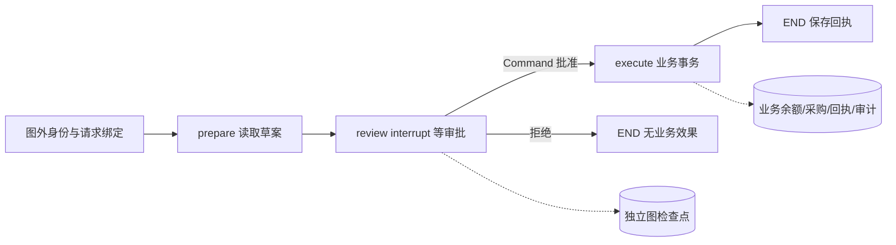

# M11第二步：持久化审批、进程重启与幂等恢复（T2）

本实验接续[T1事务账本](m11-t1-business-ledger.md)，使用真实StateGraph、SqliteSaver、interrupt和Command，验证三个案例暂停后可以在新进程恢复。所有数据和Actor均为合成教学输入；不调用模型、GPU或M02数据库。T3正式PostgreSQL及完整第11课仍待交付，本实验不是生产认证或服务器数据库验收。

## 1. 获取本批开发文件

main目前提供第0–10课；本实验在`codex/m11-enterprise-workflows`、草稿PR #9。先按[起步手册](server-start.md)保留本地修改，进入已有仓库根目录。工作区有修改或未跟踪文件时先停下并备份；干净后再执行：

```bash
git status --short
git remote set-branches --add origin codex/m11-enterprise-workflows
git fetch origin \
  refs/heads/codex/m11-enterprise-workflows:refs/remotes/origin/codex/m11-enterprise-workflows
if git show-ref --verify --quiet refs/heads/codex/m11-enterprise-workflows; then
  git switch codex/m11-enterprise-workflows
else
  git switch --track origin/codex/m11-enterprise-workflows
fi
git merge --ff-only origin/codex/m11-enterprise-workflows
git rev-parse HEAD
test -f src/enterprise_ai/workflow_cli.py
```

无法快进、出现覆盖冲突或缺文件时停止，不重置仓库。VERSION仍为main课程批次0.1.7.0，不能用它推断M11已经合并或整章完成。

## 2. 独立环境与图

使用已确认可用的Python3.12。不要在训练环境或M10复现环境覆盖安装；已有同名环境先核对用途。

```bash
python3.12 -m venv .venv-workflows
source .venv-workflows/bin/activate
python -m pip install -e .
python -m pip install -r requirements/m11-workflows.txt
python -m pip check
mkdir -p reports/local
python -m pip freeze > reports/local/m11-environment.txt
python -m unittest tests.test_workflow_store tests.test_workflow_graph tests.test_workflow_cli -v
```

固定核心为LangGraph1.2.16、checkpoint4.3.0、SQLite saver3.1.2及requirements中配套版本；M10历史环境保留。这里用显式安全类型白名单并关闭pickle。核心固定版本不等于完整跨平台锁文件，Ubuntu安装结果须保存；本地开发证据另见[验证记录](../validation/2026-10-23-m11-t2.md)。不要用skip代替框架运行。



start会记录草案和线程绑定，图在review等待。批准前可以写元数据，但不会扣假、创建采购效果或保存正式报价回执。图检查点和业务事务不在同一文件、不是原子提交；后面的故障实验专门验证这个窗口。

## 3. 暂停后在另一个进程批准休假

每条CLI命令都是独立进程。新lab目录必须不存在；重复实验改用新编号，不删除旧证据。

```bash
python -m enterprise_ai.workflow_cli init --lab reports/local/m11-approval-02
python -m enterprise_ai.workflow_cli start --lab reports/local/m11-approval-02 \
  --actor employee --thread leave-01 --key key-leave-01 \
  --case leave --arguments '{"days":3}'
python -m enterprise_ai.workflow_cli inspect --lab reports/local/m11-approval-02 \
  --actor manager --thread leave-01
```

预期status=pending、waiting_for_approval=true、next包含review。manager查看effect_count=0、resources.leave.remaining_days=15。可以关闭当前终端，重新激活同一环境、进入同一仓库后继续；不需要重新init或start。

```bash
python -m enterprise_ai.workflow_cli approve --lab reports/local/m11-approval-02 \
  --actor manager --thread leave-01
python -m enterprise_ai.workflow_cli retry --lab reports/local/m11-approval-02 \
  --actor manager --thread leave-01
```

预期status=executed、next为空、effect_count=1、余额12。retry已完成图直接返回存下的回执，余额仍12；receipt.replayed可能仍为false，因为并未重新执行execute节点。真正重跑execute后返回旧业务回执的标记见第6节。

## 4. 报价与补货共用同一审批流程

在同一lab继续：

```bash
python -m enterprise_ai.workflow_cli start --lab reports/local/m11-approval-02 \
  --actor sales --thread quote-01 --key key-quote-01 --case quote \
  --arguments '{"customer_id":1,"product_id":1,"quantity":3,"discount_percent":"15.00"}'
python -m enterprise_ai.workflow_cli approve --lab reports/local/m11-approval-02 \
  --actor manager --thread quote-01
python -m enterprise_ai.workflow_cli start --lab reports/local/m11-approval-02 \
  --actor procurement --thread buy-01 --key key-buy-01 \
  --case replenish --arguments '{"product_id":1}'
python -m enterprise_ai.workflow_cli approve --lab reports/local/m11-approval-02 \
  --actor manager --thread buy-01
```

| 案例 | 手算 | 预期 |
| -- | -- | -- |
| 报价 | 100×3×(1−15%) | total=255.00，只保存报价回执 |
| 本人休假 | 15−3 | remaining_days=12 |
| 补货缺口 | 30−(20−5+4) | quantity=11 |
| 下采购单后 | 4+11 | on_order=15，on_hand仍20 |

此时合计effect_count=3。它是manager当前租户的业务效果总数；resources是当前资源诊断，可能比历史回执更新，不是跨文件的原子快照。

## 5. 拒绝不生效

```bash
python -m enterprise_ai.workflow_cli start --lab reports/local/m11-approval-02 \
  --actor employee --thread leave-reject --key key-reject \
  --case leave --arguments '{"days":1}'
python -m enterprise_ai.workflow_cli reject --lab reports/local/m11-approval-02 \
  --actor manager --thread leave-reject
```

预期status=rejected、effect_count仍3、余额仍12。不能把拒绝改为批准；需要改变决定时创建新草案，不覆盖原请求。未批准的pending线程不能通过retry跳过审批。

## 6. 业务提交成功，图尚未完成

先申请2天。这里故意触发合成故障，命令应返回退出码5；if分支用于明确核对预期错误，不能把任何失败都当成功。

```bash
python -m enterprise_ai.workflow_cli start --lab reports/local/m11-approval-02 \
  --actor employee --thread leave-fault --key key-fault \
  --case leave --arguments '{"days":2}'
if python -m enterprise_ai.workflow_cli approve --lab reports/local/m11-approval-02 \
  --actor manager --thread leave-fault --fail-after-effect; then
  printf 'Unexpected success: preserve output and stop this exercise.\n'
  false
else
  fault_code=$?
  test "$fault_code" -eq 5
fi
python -m enterprise_ai.workflow_cli inspect --lab reports/local/m11-approval-02 \
  --actor manager --thread leave-fault
```

预期错误synthetic_after_effect_failure；检查时业务status已executed、effect_count=4、余额10，但next仍包含execute、graph_failed=true、图回执尚未保存。业务已提交，不能因为图报错就盲目新建请求。

```bash
python -m enterprise_ai.workflow_cli retry --lab reports/local/m11-approval-02 \
  --actor manager --thread leave-fault
```

预期status=executed、next为空、receipt.replayed=true，effect_count仍4、余额仍10。业务幂等回执阻止第二次扣减，而非依赖模型“记住做过”。审批/拒绝已经提交但图保存失败的窗口也由账本恢复；retry只能重用已有决定，不能接受新批准参数。

## 7. 权限、锁与故障定位

CLI的sales/employee/procurement/manager是固定合成身份，tenant仅支持1/2。它不是登录认证，不能直接开放成HTTP接口。真正授权依据是图外registry和业务账本；模型/恢复JSON不能替换owner、tenant或角色。同名thread在两个tenant间使用不同实际checkpoint ID。

| 退出码 | 含义 | 下一步 |
| -- | -- | -- |
| 0 | 操作成功或图正常暂停等待 | 检查status和next |
| 1 | 存储/框架等未分类失败 | 保留日志，inspect后定位，勿盲重建 |
| 2 | 参数、既有目录、状态或不可反转决定不合法 | 核对字段/目录/线程状态 |
| 3 | 身份不允许，含他人线程、错租户、非manager审批 | 不放宽角色绕过 |
| 4 | 同一lab另有操作 | 等操作结束后重试，不删除锁文件 |
| 5 | 明确启用的业务提交后合成故障 | 按第6节inspect和retry |

lab锁会串行化所有线程，忙时立即拒绝；进程退出自动释放OS锁，operation.lock文件本身保留。不要删除锁文件来“解锁”。自动测试还会在业务提交后以os._exit(23)终止专用子进程，再由新进程恢复，确认余额与效果次数保持一致；这不是服务器掉电或PostgreSQL高可用验收。

business.sqlite、control.sqlite、checkpoints.sqlite除类型外还绑定同一个lab编号；缺失、编号不一致或没有编号的旧开发库会拒绝打开，不创建空库或补表修复。保留旧实验，按新编号另建lab；不要把T1单文件库直接搬进T2。编号用于防止误混用，不是抵御管理员伪造的签名。整个lab属于本地可信实验者；不保证抵御管理员直接篡改文件。正式备份/恢复与服务端认证在后续模块，不要仅复制一个热SQLite文件并当作完整备份。

## 8. 验收与练习

保存代码commit、Python路径/版本、pip check/freeze、命令退出码和脱敏JSON。先完成第3–6节，再执行全量`python -m unittest discover -s tests -v`，与[本地验证边界](../validation/2026-10-23-m11-t2.md)区分。

1. 用两个线程各申请10天，解释为什么第二笔需要新草案而不是无限retry。
2. 保持相同幂等键但修改days，观察拒绝；不要用新键掩盖重复请求。
3. 用employee批准自己的线程、用tenant2查询tenant1线程，确认退出码3且没有效果增加。
4. 解释为什么正常retry的replayed可能false，而故障后execute重跑应true。

官方资料：[interrupt与恢复](https://docs.langchain.com/oss/python/langgraph/interrupts)、[持久化与checkpointer](https://docs.langchain.com/oss/python/langgraph/persistence)、[SQLite saver固定版本](https://pypi.org/project/langgraph-checkpoint-sqlite/3.1.2/)。本教程按固定1.2.16 API实现，不要求照抄官方后续新API示例。下一阶段T3正式PostgreSQL，完整第11课未发布。
