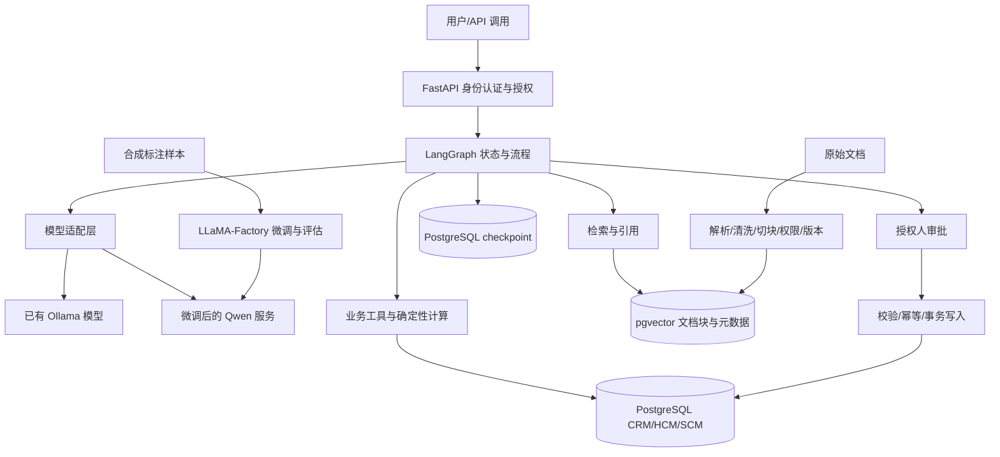

# 企业 AI Agent 教学平台设计草案

日期：2026-10-15。用途：课程与实现范围。状态：用户已确认方案，批准先实施 M01–M02；本文不代表已部署系统。

## 1. 已确认约束

- 学员具有 Python、Linux、Hadoop 基础，以未来 FDE 与 AI Agent 定制交付为目标。
- 本地只保存和编辑代码与文档，不安装平台运行环境，不运行训练或数据库服务。
- 用户自行通过 GitHub 同步到 Ubuntu 并执行操作；目前没有授予服务器登录权限。
- Ubuntu 24.04 Server amd64，128GB RAM，RTX 4090D 24GB；磁盘容量、驱动具体版本尚待 M00 确认。
- 当前通过 Ollama 运行名为 `qwen3.8:27b` 的模型。该名称不作为官方模型身份的证明。
- GitHub 仓库为 `zhangyg2007/enterprise-ai-agent-platform`；访问检查时为空、公开，当前账号具备 ADMIN 权限。

## 2. 架构与技术选择

业务数据库保存事实，知识库提供证据，模型理解和生成，LangGraph 编排步骤，业务代码执行有约束的计算与写入。



首版使用一个 PostgreSQL 实例、逻辑分离的业务/知识库/运行状态空间。迁移用户、业务只读用户、受限写入用户和 checkpoint 用户分开配置。应用不使用数据库超级用户。

| 组件 | 选择 | 理由与边界 |
|---|---|---|
| 系统 | Ubuntu 24.04 amd64 | 与现有服务器一致 |
| 应用 Python | M01 使用 Ubuntu 默认 3.12，支持 3.11–3.13 | 避免起步更换系统 Python；训练环境后续单独使用 3.11 |
| 数据库 | PostgreSQL，实施时固定版本 | 同时学习事务、关系建模、权限与向量检索 |
| 向量检索 | pgvector | 减少初期基础设施；先精确检索再学习近似索引 |
| Embedding | BAAI/bge-m3，初期只用 dense | 中文及多语言教学；1024 维；稀疏、多向量作为扩展 |
| 训练 | LLaMA-Factory，固定 release | WebUI 理解参数，CLI 保证复现 |
| 起步训练模型 | Qwen/Qwen3-4B-Instruct-2507 | 非思考模型，适合聚焦结构化输出；模板 qwen3_nothink |
| 编排 | LangGraph 1.x | 明确状态、分支、恢复和人审 |
| HTTP 服务 | FastAPI | 自行实现认证、并发、持久化与运维，便于理解交付边界 |
| 运行管理 | Compose + 明确启动/停止流程 | 单机教学；不宣称高可用 |
| 可观测 | 本地结构化日志与实验报告 | LangSmith 为可选扩展，外传数据前确认范围 |

LangGraph 使用 `StateGraph`、`invoke/ainvoke`、`interrupt()` 和 `Command(resume=...)` 作为基础。高层 Agent 使用 LangChain v1 的 `create_agent`，不把已弃用的 `create_react_agent` 作为主教材。滚动文档中的新 API 必须对照锁定版本，不把“1.x”误当成全部版本功能一致。[官方 v1 说明](https://docs.langchain.com/oss/python/releases/langgraph-v1)

数据库、向量模型、训练环境、推理环境分别记录版本。依赖范围不等于锁文件，只有实际验证后才标记为“已验证组合”。

## 3. 服务器资源与模型策略

划分三个独立 Python 环境：应用、训练、推理。保留系统 CUDA 与现有 Ollama；先核查兼容关系，不默认卸载或升级驱动。

`nvidia-smi`、`nvcc --version`、`torch.version.cuda` 分别用于检查驱动支持、Toolkit、PyTorch 构建运行时。较新驱动可以运行兼容的较旧 CUDA 构建，不能因为用户报告 CUDA 13 就把所有软件强制装成相同版本。[NVIDIA 兼容说明](https://docs.nvidia.com/deploy/cuda-compatibility/why-cuda-compatibility.html)

24GB 显存下，首个训练实验采用 4B QLoRA、短上下文、micro-batch 1、梯度累积，先以 32–64 条样本、10–20 step 检查流程。起始参数参考官方 Qwen3 QLoRA 示例，随后按设备实测调整；不承诺固定显存占用。[官方示例](https://github.com/hiyouga/LlamaFactory/blob/main/examples/train_qlora/qwen3_lora_sft_otfq.yaml)

训练前释放占用 GPU 的推理工作负载；索引构建、训练和大模型推理分时运行。Embedding 可先 CPU 运行，后续用同一数据比较批量 GPU 编码效果。128GB RAM 可用于缓存、数据库和 CPU 合并，但不能替代训练所需的 GPU 显存。

待 M00 核实的现有 Ollama 模型作为推理对照；名称中的 27b 暂不作为已确认的参数规模。训练模型重新下载官方 Hugging Face 权重、tokenizer 和 config；不直接把 Ollama 的量化模型文件当作本教程的标准训练输入。4B 完成后再研究 7/8B，27B 级模型微调属于额外资源实验。

Qwen3-4B-Instruct-2507 仅非思考模式；不对它套用需要思考输出的教学模板。[模型卡](https://huggingface.co/Qwen/Qwen3-4B-Instruct-2507)

## 4. 虚构企业与结构化数据

企业名称：星桥工业服务（纯教学虚构）。主营工业设备配件销售与采购，内部有销售、采购、仓储、人事部门。另设一个虚构租户，用于跨租户隔离测试。所有人名、公司、联系方式和交易均为合成数据；邮箱使用保留的示例域名。

| 领域 | 核心实体 | 业务关系与学习点 |
|---|---|---|
| CRM | customers、contacts、opportunities、sales_orders、sales_order_items、quotes | 客户→商机→报价→订单；金额精度、状态流转、客户负责人 |
| HCM | departments、employees、leave_balances、leave_requests | 部门与员工；本人可见范围；申请与审批；薪酬只作权限专题 |
| SCM | suppliers、products、warehouses、inventory、purchase_orders、purchase_order_items、inventory_movements | 供应商与产品；库存流水；采购在途；可用库存计算 |
| 平台 | tenants、users、role_bindings、approval_requests、audit_events | 服务端身份、角色授权、审批、审计 |

计划采用三档数据：

- tiny：20 客户、30 员工、40 SKU、100 销售订单、30 采购订单，用于手工核算和自动测试。
- standard：1,000 客户、500 员工、2,000 SKU、20,000 销售订单、5,000 采购订单，用于查询和索引实验。
- scale：按生成器参数扩展到百万级明细，用于批量导入和性能专题，不作为首课要求。

这些是实体数量目标，明细表行数由业务规则生成。固定随机种子和场景时钟，保存数据清单与摘要。金额用 decimal/numeric，库存数量区分单位；订单总额从明细确定性计算。

租户作用域参与主外键或唯一性约束，防止跨租户关联。生成器提供固定异常场景：缺货、供应商延期、过期制度、重复文件、待审批申请、未知客户。无效数据进入隔离区，不默认污染正常数据。

MySQL 作为后续“已有系统接入”案例，讲解只读连接、字段映射、增量同步、水位线、删除事件和对账，不承诺 PostgreSQL SQL 原样通用。

## 5. 微调数据与实验设计

任务聚焦意图分类、业务字段提取、标准答复格式和工具参数表达。动态库存、余额、员工隐私不作为需要模型记忆的知识灌输。

计划先提供 200 条人工可审查的核心样本，再通过受控模板扩充到 2,000–5,000 条；扩充量不代表质量。每条记录附来源、任务类型、实体组和生成规则，人工抽查每类样本。

先按实体/原始文档家族划分 train/validation/test，建议 80/10/10，再做改写和切块，避免同源变体跨集合。另设冻结的人工挑战集，包含未知字段、权限拒绝、证据不足和格式干扰；不用于调参。

教程顺序：Alpaca 单轮→ShareGPT 多轮→工具调用数据专题。微调前后使用同一测试集和生成设置，报告 JSON 有效率、字段准确率、任务正确率、拒答行为、延迟和资源。训练 loss 下降不是业务改进证明。[LLaMA-Factory 数据准备](https://llamafactory.readthedocs.io/en/latest/getting_started/data_preparation.html)

训练环境保留模型 revision、框架版本、配置、种子、数据 hash 和日志。导出时保存 adapter；若合并，加载原始未量化基座并按官方合并流程执行，重复评估合并后结果。[合并说明](https://llamafactory.readthedocs.io/en/latest/getting_started/merge_lora.html)

进行四组对照：基础模型、基础模型+RAG、微调模型、微调模型+RAG。业务实时数据通过相同工具提供，以便区分训练、检索和工具的贡献。

## 6. 知识库数据与处理

首批计划提供 30 篇人工可核对的制度、产品、采购和操作文档，再扩展到 300–1,000 篇合成文档。数量扩展用于流水线和性能实验，不以重复模板宣称知识覆盖充分。

先支持 Markdown 和文本，再增加文本 PDF、DOCX、表格；扫描 PDF/OCR 单列进阶专题。合成 HCM 制度仅用于教学业务规则，不作为现实劳动法规说明。

流水线：发现文件→计算 hash→解析→结构清洗→按标题/段落切分→元数据与 ACL→embedding→入库→质量检查。

每个 chunk 保留 tenant_id、document_id、版本、生效时间、可见角色、来源路径、页码或章节、内容 hash、embedding 模型 revision。解析失败保留原因和源文件，不将空文本静默写入索引。

重复导入应幂等。更新采用新版本与旧版本失效；删除文档要撤销对应检索记录。先过滤可见范围与有效版本，再给模型证据。检索缓存也必须包含租户、权限和文档版本信息。

BGE-M3 dense 为 1024 维；更换模型必须重建对应向量空间，不混用新旧 embedding。[模型卡](https://huggingface.co/BAAI/bge-m3)

先用 pgvector 精确检索形成基线，再对比 HNSW。中文关键词基线显式分词，随后与向量结果融合并选做重排，不直接把 PostgreSQL 的 english 分词配置用于中文。近似索引叠加过滤后可能返回不足，需测量召回并调整候选策略。[pgvector 文档](https://github.com/pgvector/pgvector)

RAG 输出引用文档 ID、版本、页码/章节。证据不足或制度冲突时明确说明缺口，避免生成无来源业务承诺。

## 7. Agent 设计与三个案例

先教显式路由工作流，再讲模型选择工具。模型只提出工具参数和业务建议；确定性代码负责数值、授权、状态转换与写入。

| 案例 | 输入与流程 | 正常结果 | 关键验收 |
|---|---|---|---|
| CRM 报价助手 | 查询客户与订单→检索折扣政策→计算报价→必要时审批 | 带计算明细、政策引用的报价草案 | 金额准确、折扣边界、批准前无正式变更 |
| HCM 员工服务 | 识别当前用户→查本人余额→检索适用制度→发起申请→主管审批 | 带依据的余额答复或申请记录 | 不读取他人信息、拒绝不扣余额、审批者权限正确 |
| SCM 补货助手 | 查库存与在途→计算缺口→检索采购制度→生成草案→采购审批 | 可解释的补货建议和采购草案 | 单位一致、提交前重查库存、防重复采购 |

工具初期采用白名单，如 get_customer_summary、get_my_leave_balance、get_inventory。用户和租户标识来自服务端认证上下文，不接受模型自行声明。SQL 参数化、最大行数、超时、只读角色分别落实。任意 Text-to-SQL 只在隔离的选修实验中提供。

会话 checkpoint、跨会话记忆和知识库是不同数据层。正式恢复实验使用 PostgreSQL checkpointer；内存 checkpointer 仅用于单进程入门。首次 setup 作为显式迁移步骤。

审批流程为：提出动作→展示参数和资源版本→授权人决定→再次校验权限和业务状态→事务执行→审计。thread_id 不是访问凭证；服务端校验线程归属。同一线程请求串行化或明确拒绝并发。

`interrupt()` 恢复会重跑所在节点，故审批与有副作用的执行分节点，业务写入使用幂等键和唯一约束。checkpoint 不自动保证业务只执行一次。[持久化](https://docs.langchain.com/oss/python/langgraph/persistence) · [中断与恢复](https://docs.langchain.com/oss/python/langgraph/interrupts)

异常处理包括：模型超时有限重试、只读工具失败可重试、写操作重试先检查幂等结果、证据不足返回缺口、权限失败直接拒绝。对工具次数、执行时长、输入长度和输出预算设上限。

## 8. 部署、权限与交付

默认自建 FastAPI 调用开源 LangGraph，自己负责认证、连接池、并发、checkpoint、审计和监控。LangSmith 观测与 LangSmith Deployment 是不同选项，不将商业部署服务列为默认必需品。[部署选项](https://docs.langchain.com/langsmith/deployment)

学习阶段数据库与管理端口绑定回环地址，通过 SSH 隧道访问。对外发布 API 是 M12 独立步骤，需完成认证、TLS、限流和运行记录。真实凭证保存在服务器配置或密钥机制中；仓库仅提供空值模板。

RLS 作为数据库防线时，应用角色不能是超级用户、BYPASSRLS 用户或未经约束的表所有者；配合应用权限检查及跨租户测试。[PostgreSQL RLS](https://www.postgresql.org/docs/current/ddl-rowsecurity.html)

数据库备份包含业务数据、知识库元数据和运行状态；embedding 可重建，但需保存模型 revision 与源数据。恢复演练写入独立测试库，禁止把恢复演示指向正式库。

FDE 交付包包括需求访谈、现状系统清单、数据访问矩阵、接口与数据契约、方案选择记录、评估报告、演示脚本、部署/备份/恢复/回滚手册、已知限制和验收签字页。

## 9. 计划目录和实现边界

以下为目标结构。截至 2026-10-16，已提供第 0–2 课、数据库初始化、数据生成与查询工具和测试；模型、检索、Agent 与 API 尚未实现。

```text
docs/                中文教程、架构、实验题、运行手册与证据
infra/               Compose、数据库迁移与服务配置
src/enterprise_ai/   数据工具、模型适配、检索、Agent、API
scripts/             数据生成、导入、评估、健康检查
configs/             模型、训练、检索与应用的配置模板
data/samples/        少量可审查的合成数据与数据卡
tests/               无模型测试、数据库集成、模型评估入口
```

大数据、原始模型、adapter、缓存、数据库卷和本机配置使用 Git 忽略路径，生成规则和数据摘要入库。日志需要脱敏，避免公开仓库记录真实业务输入。

实施顺序按 ROADMAP。每个子项目在实现前单独细化文件、接口和测试；当前文档不把整个平台压成一次不可审查的开发任务。

## 10. 验证与验收边界

本地只运行已有工具支持的静态检查，不安装新依赖或平台服务。服务器测试命令由教程提供，用户执行并返回证据。CI 后续可做不依赖 GPU 的检查，不能据此宣称 GPU 实验通过。

验证 pass 检查事实证据；独立 review pass 检查设计/代码缺陷。两者分开。最终报告区分已撰写、已静态检查、已服务器验证、未验证与已知问题。

用户已确认的设计决策为：以 PostgreSQL 单机路线起步；微调采用 Qwen3-4B-Instruct-2507；先实施 M01–M02，后续逐模块交付。公开仓库只含原创合成样本和可公开教程。
