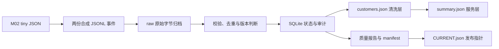

# 第 3 课：把客户变更加工成可追溯的数据

本课对应 M03。你将用 M02 的 40 个合成客户，练习数据契约、清洗、去重、增量更新、删除传播和坏数据隔离，最终得到 39 个有效客户与租户汇总。后续微调数据和知识库索引也会面对重复、过期和删除问题；先把这些规则做成可验证的程序，再接入模型。

**本文所有操作命令都在 Ubuntu 服务器执行。** 本模块使用 Python 标准库及其 SQLite 支持，不需要启动 PostgreSQL、下载模型或安装数据平台。SQLite 在本课保存 ETL 状态，不替换 M02 的企业数据库。本地只保存代码和操作文档。

本课对应课程版本 0.1.1.0。**先确认服务器提交包含 M03，再更新代码执行本课。** 以下结果是固定样例的验收预期；服务器执行记录需要你实际采集。

## 1. 业务问题与学习目标

假设 CRM 每天交付一份客户变更文件：销售修改客户名称，管理员删除重复客户，网络重试又发送同一条消息，某些旧消息晚一天才到达。简单地把文件追加到表里，会出现客户重复、旧名称覆盖新名称、已删除客户重新出现等问题。

完成本课后，你应能解释并验证以下规则：

- 原始文件保留来源，清洗结果可追溯到批次和行号。
- 相同消息只处理一次，相同文件重跑不会重复累计。
- 用每个客户自己的版本号判断更新；迟到消息不能覆盖新状态。
- 坏行被隔离并计入质量报告，其他合法行继续处理。
- 删除从当前客户清单传播到租户汇总，同时保留防止旧消息复活客户的版本信息。
- 数据库提交与文件发布有不同的故障边界，需要分别恢复。

这里用合成文件事件模拟变更流。它没有订阅 PostgreSQL 日志，也没有实现真实 CDC、生产调度、企业认证或多用户访问权限。

## 2. 原始层、清洗层与服务层



| 层或文件 | 内容 | 解决的问题 |
|---|---|---|
| 输入 JSONL | 一行一个客户事件 | 逐行处理和定位错误 |
| `raw/<sha256>.jsonl` | 输入文件的原始字节 | 保留原件，文件名变化不影响批次身份 |
| `state.sqlite3` | 批次、事件、当前实体、隔离记录和元信息 | 事务、去重、版本判断及审计 |
| `customers.json` | 所有未删除客户的最新状态 | 提供当前有效的客户清单 |
| `summary.json` | 每租户有效客户数量 | 提供业务汇总；包括数量为 0 的已知租户 |
| `report.json` | 本次请求批次的质量统计 | 解释哪些输入生效、重复、迟到或隔离 |
| `manifest.json` | seed 摘要、批次摘要、累计批次数和导出文件摘要 | 追踪版本并校验文件完整性 |
| `CURRENT.json` | 当前 manifest 的相对路径与摘要 | 指向一套完整发布的快照 |

清洗层和服务层是逻辑分层，不要求各自部署独立数据库。此处把它们放在同一个快照目录里，便于一次发布客户清单与其汇总，避免读到不同批次的两份结果。

Python 的 `sqlite3` 模块访问本地数据库文件，无需单独的数据库服务进程；写入仍需明确事务边界。参见 [Python 3.12 sqlite3 文档](https://docs.python.org/3.12/library/sqlite3.html)。

## 3. 冻结事件契约

每一行必须恰好包含以下六个字段，不允许静默忽略多余字段：

| 字段 | 含义与约束 |
|---|---|
| `event_id` | 全源唯一事件 ID；非空文本，最多 128 字符；拒绝控制字符和代理码字符 |
| `tenant_id` | 租户 ID，必须存在于本次固定的 M02 seed |
| `customer_id` | 客户 ID，与租户 ID 组成实体键；可表示新客户 |
| `version` | 同一实体单调递增的正整数版本，不是批次序号 |
| `op` | 只能是 `upsert` 或 `delete` |
| `payload` | upsert 时恰好包含 `name` 和 `owner_employee_id`；delete 时必须为 `null` |

租户、客户、版本和负责人 ID 都只接受 `1..2147483647` 的整数。`true`、`1.5`、`"2"` 不会被隐式转成合法整数。负责人必须是同一租户的员工。客户名最长 200 字符，拒绝空白名称、控制字符和代理码字符，只清除名称首尾空白，不改写名称内部文本。

下面是说明结构的例子，不是要求手工替换已生成文件：

```json
{"event_id":"crm-1-1-v2","tenant_id":1,"customer_id":1,"version":2,"op":"upsert","payload":{"name":"星桥客户一（更新）","owner_employee_id":1}}
```

JSONL 按 UTF-8 读取，接受 LF 和 CRLF。每个文件最多 20 MiB，每行最多 64 KiB（不含行尾 CRLF）；超限或非 UTF-8 会使整批失败。空行、非法 JSON、重复 JSON 键、`NaN` 和 `Infinity` 会作为坏行隔离。末尾正常换行不额外算一行。

标准库 JSON 解析器有可调整的重复键和特殊数字行为，本课主动收紧解析规则，避免不同消费者对同一输入作出不同解释。参见 [Python JSON 文档中的标准兼容性说明](https://docs.python.org/3.12/library/json.html#standard-compliance-and-interoperability)。

### 3.1 三种身份不能混用

1. **批次身份**：整个输入文件原始字节的 SHA256。同内容改名仍是同批；改变换行或空白会成为不同批次。
2. **事件身份**：`event_id` 加上清洗前的规范 JSON 内容。JSON 键顺序和格式空白不影响内容比较，名称里的空白仍属于事件内容。
3. **实体身份**：`(tenant_id, customer_id)`。两个租户的客户 1 是两个客户，不能只用 `customer_id` 去重。

因此，把某个客户名从 `"  客户一  "` 改成 `"客户一"` 后继续使用原事件 ID，会被判断为事件内容冲突，尽管清洗后名称相同。修正事件应按源系统规则产生新的事件 ID 和合理版本，保留原始事件的证据。

### 3.2 处理顺序

先校验结构与引用，再检查事件 ID，最后比较实体当前版本：

| 情况 | 处理结果 |
|---|---|
| 已登记 ID，规范内容相同 | `duplicate`，不改实体 |
| 已登记 ID，内容不同 | `EVENT_CONFLICT` 隔离，不改实体 |
| 新 ID，版本低于当前版本 | `stale`，登记事件但不改实体 |
| 新 ID，版本等于当前版本 | `VERSION_CONFLICT` 隔离，同时登记事件 ID |
| 新 ID，版本高于当前版本，或没有当前实体 | `applied`，执行更新或保留删除标记 |

结构和引用合法但发生版本冲突的事件，其 ID 也被冻结：以后重送原内容算 duplicate，换内容继续用该 ID 仍是 EVENT_CONFLICT。非法 JSON、非法结构、未知租户或未知负责人只保存隔离记录，不登记事件 ID；修正这些数据时仍建议产生新的事件 ID，避免混淆审计。

这里比较的是**当前**实体版本，不是完整历史版本索引。不同事件 ID 的更低版本会归为 stale，不进一步判断该历史版本是否曾出现另一内容。

删除保留 tombstone（删除标记）及版本。这样客户被 v2 删除后，迟到的 v1 不会使它复活；新的 v3 upsert 可以恢复它。即使删除事件先于首次新增到达，也要保存删除版本。

## 4. 前置条件与服务器准备

需要第 1 课的项目目录、Python 虚拟环境，以及第 2 课生成的 `tiny.json`。本课无需数据库健康检查，但不会替代 M02 的服务器数据库验收。

确认 M03 已发布后，先在服务器检查分支与本地修改：

```bash
cd "$HOME/projects/enterprise-ai-agent-platform"
git status --short --branch
```

确认当前分支是 `main`，且输出中没有本地修改或未跟踪的项目文件，再逐条执行更新和检查。若处于其他分支，先弄清该分支用途并保存工作，再切回 main；不要直接把 main 拉入另一分支。

```bash
git pull --ff-only origin main
. .venv/bin/activate
git log -1 --format='%h %s'
python -m enterprise_ai.governance --help
python -m enterprise_ai.governance_demo --help
python -m enterprise_ai.data validate data/generated/tiny.json
```

如果有本地代码修改或更新冲突，先保存并检查差异，不使用强制覆盖。若模块不存在，检查当前提交是否包含 M03。M01 使用 editable 安装，新增源码模块随代码更新可见；本章没有增加第三方依赖。

若从未生成 tiny，可运行下面命令一次；已有文件时继续使用并校验，不覆盖它：

```bash
python -m enterprise_ai.data generate --profile tiny --seed 42 --output data/generated/tiny.json
```

为实验文件和报告设置默认权限：

```bash
umask 077
mkdir -p reports/local
git check-ignore data/generated/tiny.json reports/local/
```

本课的工作目录不是权限隔离系统。可读取文件的操作系统用户也可能读取原始输入和审计数据；不要用这套教学目录保存真实员工或客户资料。

## 5. 创建两份教学输入

```bash
python -m enterprise_ai.governance_demo create --seed data/generated/tiny.json --output data/generated/m03-inputs
```

程序拒绝覆盖已存在的输出目录。首次成功后生成：

```text
data/generated/m03-inputs/
  01-initial.jsonl
  02-changes.jsonl
  data-card.json
```

数据卡标记 `synthetic: true`，记录 seed 摘要、两个文件的行数（44 和 7）以及最终预期客户数 39。这里从 M02 tiny 文件获取客户和员工引用，**不会读取或修改 M02 PostgreSQL 库**。

第一批含全部 40 个客户的 v1 upsert；第一个客户名被加上首尾空白，以演示清洗。随后是第一条事件的原样重复，以及三条坏行：非法 JSON、租户 99、负责人 9999。

第二批含 7 行：更新租户 1 客户 1 到 v2、删除租户 1 客户 2 到 v2、一条迟到 v1、同 ID 内容冲突、同当前版本不同 ID 冲突、布尔版本非法，以及首批第一条事件的原样重复。

## 6. 导入第一批，核对质量统计

```bash
python -m enterprise_ai.governance run --seed data/generated/tiny.json --input data/generated/m03-inputs/01-initial.jsonl --workspace data/generated/m03-warehouse
python -m enterprise_ai.governance inspect --workspace data/generated/m03-warehouse
```

首次 `run` 的关键字段应为：

```json
{"rows":44,"applied":40,"duplicate":1,"stale":0,"quarantined":3,"cleaned":1,"unchanged":false}
```

实际输出还包含 `batch_digest`。`inspect` 会先验证发布指针、manifest 和三个数据文件的摘要，再输出 `manifest`、`summary`、`report`。此时 summary 中租户 1 和 2 各有 20 个有效客户。

统计关系是 `rows = applied + duplicate + stale + quarantined`。`cleaned` 是 applied 的子集，表示实际应用且名称被 trim 的行，不能再加到总行数上。

**退出码 0 表示本批处理和发布完成，不表示输入全部合格。** 这里的三条隔离记录是预设教学错误。生产接入时应按业务约定设置坏数据阈值、告警和处置责任，不能只看退出码。

## 7. 导入增量并验证删除传播

```bash
python -m enterprise_ai.governance run --seed data/generated/tiny.json --input data/generated/m03-inputs/02-changes.jsonl --workspace data/generated/m03-warehouse
python -m enterprise_ai.governance inspect --workspace data/generated/m03-warehouse
```

首次导入第二批的关键统计应为：

```json
{"rows":7,"applied":2,"duplicate":1,"stale":1,"quarantined":3,"cleaned":0,"unchanged":false}
```

汇总应为：

```json
[{"tenant_id":1,"active_customers":19},{"tenant_id":2,"active_customers":20}]
```

当前客户清单中 `(1,1)` 的名称为 `星桥客户一（更新）`、版本为 2；`(1,2)` 已不在清单中，`(2,2)` 仍保留。迟到和冲突事件都没有覆盖有效更新。

CLI 不直接打印全量客户。如需检查这三个对象，在服务器使用会校验摘要的读取函数：

```bash
python - <<'PY'
from pathlib import Path
from enterprise_ai.governance import inspect_workspace

snapshot = inspect_workspace(Path('data/generated/m03-warehouse'))
rows = {(row['tenant_id'], row['customer_id']): row for row in snapshot['customers']}
assert len(rows) == 39
assert rows[(1, 1)]['version'] == 2
assert rows[(1, 1)]['name'] == '星桥客户一（更新）'
assert (1, 2) not in rows and (2, 2) in rows
print('客户更新、跨租户边界和删除传播检查通过')
PY
```

## 8. 重跑不是重新累计

再次执行同一个第二批文件：

```bash
python -m enterprise_ai.governance run --seed data/generated/tiny.json --input data/generated/m03-inputs/02-changes.jsonl --workspace data/generated/m03-warehouse
python -m enterprise_ai.governance inspect --workspace data/generated/m03-warehouse
```

`unchanged` 应为 `true`，其余统计仍返回该批首次处理的数字。客户数保持 39，manifest 的 `committed_batches` 保持 2，隔离表保持 6 行。

重跑会再次发布当前全部已提交状态，所以可能新增一个不可变快照目录。这是文件恢复机制，不是业务数据重复。若增量后重跑第一批，返回第一批报告，但发布的客户仍是目前的 39 个，不会回到最初的 40 个。

`report.batch_digest` 标识本次请求的批次，`manifest.committed_batches` 表示累计已提交批次数。report 不汇总整个历史，也不能仅凭其中 applied 数推断当前客户总量。

## 9. 追踪隔离记录与验收

隔离表保存批次摘要、原文件行号、错误码和原始文本。课堂先只查看错误类型与计数，避免把原文无意写进日志：

```bash
python - <<'PY'
from pathlib import Path
from contextlib import closing
import sqlite3

path = Path('data/generated/m03-warehouse/state.sqlite3').resolve()
with closing(sqlite3.connect(path.as_uri() + '?mode=ro', uri=True)) as connection:
    for code, count in connection.execute(
        'SELECT error_code, count(*) FROM quarantine GROUP BY error_code ORDER BY error_code'
    ):
        print(code, count)
    print('已提交批次', connection.execute('SELECT count(*) FROM batches').fetchone()[0])
PY
```

完整两批后应看到以下每种错误各 1 次：`INVALID_JSON`、`UNKNOWN_TENANT`、`UNKNOWN_OWNER`、`EVENT_CONFLICT`、`VERSION_CONFLICT`、`INVALID_EVENT`。最后一种来自布尔版本。已提交批次应为 2。

执行独立验收并保存证据。以下命令逐条执行：任意一步返回非 0 就停止，保留终端中的 stderr 并排查，不以随后另一条命令成功来判断前一步通过。报告文件存在也不等于验收成功，因为重定向可能在失败时留下空文件。

```bash
python -m enterprise_ai.governance_demo verify --seed data/generated/tiny.json > reports/local/m03-verification.json
python -m enterprise_ai.governance inspect --workspace data/generated/m03-warehouse > reports/local/m03-current.json
git log -1 --format='%H %s' > reports/local/m03-code-version.txt
cat reports/local/m03-verification.json
```

verify 在当前项目目录下创建临时目录，重新生成两批输入并独立重放、重复运行、校验快照；结束后清理临时实验。它不会操作你的 `m03-warehouse`，但要求当前目录可写。

成功时包含 `status: "passed"`、`active_customers: 39` 和六类检查：初始质量、批次幂等、增量质量、删除传播、租户边界、迟到与冲突保护。`scope` 明确限定为合成文件 ETL 和 SQLite，不涉及 PostgreSQL 或模型。它验证程序在当前服务器上的样例路径；自己的工作目录仍由 inspect 和前述查询检查。

## 10. 事务与文件发布的恢复边界

程序顺序是：获取工作目录排他锁 → 检查文件级约束和 seed → 保存 raw → SQLite `BEGIN IMMEDIATE` → 提交全部事件与批次状态 → 写入新快照 → 原子替换 `CURRENT.json`。

SQLite 允许多个读事务，但同时只有一个写事务。`BEGIN IMMEDIATE` 提前申请写事务；本课又用 `.lock` 限制同一个目录只有一个流水线进程。参见 [SQLite 事务说明](https://www.sqlite.org/lang_transaction.html)。

| 故障位置 | 可能留下什么 | 正确恢复方向 |
|---|---|---|
| UTF-8 或文件/行大小检查失败 | 没有本批状态提交 | 保留原件，修正编码或拆分输入后重试 |
| raw 保存后、SQLite 提交前失败 | raw 原件可能已存在；事务内状态回滚 | 排查原因，使用同一 seed、输入和工作目录重跑 |
| SQLite 已提交、快照尚未发布 | 新状态已在数据库；旧 CURRENT 仍可能可用，首次运行也可能没有 CURRENT | 修复磁盘或权限问题后重跑同批，程序识别已提交并重新导出 |
| CURRENT 已发布 | 指向完整快照 | 先 inspect 验证摘要，再交给下游消费 |

SQLite 事务和文件发布**不是同一事务**。不应因为命令返回非 0 就推断 SQLite 一定没有提交。正常重试是恢复发布的一部分。读者应跟随 CURRENT，不应挑选字典排序最大的快照目录或直接读取尚未发布的新文件。

摘要检测意外损坏，不是数字签名；能改写全部文件和摘要的用户仍可伪造内容。本实现也不承诺网络文件系统或突然断电场景的持久性。不要据此直接宣称达到生产级“端到端 exactly-once”。

### 10.1 删除传播与隐私擦除

删除使客户从当前清洗清单和汇总消失，但 tombstone、原始事件、审计表、隔离文本和历史快照仍可能保留姓名。**业务删除不等于隐私擦除。** 真实场景还要设计保留期限、历史数据清理、备份处置和访问控制；本课仅使用合成数据，不提供隐私擦除实现。

### 10.2 备份和重新实验

备份前停止对此工作目录的所有写入，并确认没有进程正在运行。应保留 seed、原始输入、整个 warehouse 和代码提交号，不能仅备份 CURRENT 或只复制一个客户文件。这里不提供运行中直接拷贝 SQLite 文件的备份命令。

若要从零重放，保留旧目录，另选新目录即可：

```bash
python -m enterprise_ai.governance run --seed data/generated/tiny.json --input data/generated/m03-inputs/01-initial.jsonl --workspace data/generated/m03-replay
python -m enterprise_ai.governance run --seed data/generated/tiny.json --input data/generated/m03-inputs/02-changes.jsonl --workspace data/generated/m03-replay
python -m enterprise_ai.governance inspect --workspace data/generated/m03-replay
```

新旧工作目录的客户与汇总应一致；快照 UUID 不要求相同。不能混用不同 seed。后续若改变流水线 schema，当前版本会拒绝不匹配目录，不会隐式迁移旧实验状态。

## 11. 常见故障

| 现象 | 检查与处理 |
|---|---|
| `No module named enterprise_ai.governance` | 确认 M03 已发布、服务器已更新并激活 M01 的环境；检查是否仍在旧提交 |
| create 失败且目录已存在 | 检查三个输入文件；复用完整原件或另选新目录，不覆盖旧证据 |
| seed 不匹配 | 检查 tiny 是否重新生成过；旧状态必须用原 seed，新的 seed 使用新工作目录 |
| run 返回 FileExistsError | 检查 `.lock` 是否由仍在运行的进程持有；不要为了绕过锁直接启动第二个写入程序 |
| 崩溃后 `.lock` 残留 | 查看锁内 PID 并结合系统进程和运行任务确认无人使用；PID 可能被复用，不能仅凭编号推断。确认停止且备份后，再人工处理这一把残留锁 |
| `inspect` 找不到 CURRENT | 首次 run 未成功发布或工作目录写错；按失败位置恢复，然后重跑原批次 |
| raw 或快照摘要不一致 | 停止把该目录交给下游，保留损坏证据；不要手工改摘要“修复”。从可信备份恢复，或用可信 seed 与输入在新目录重放 |
| 返回 0 但 quarantined 非 0 | 查看质量报告和隔离错误码；这不是全量数据质量通过的证明 |
| 返回非 0 且提示通用错误 | CLI 有意不打印原始客户行；先检查路径、空间、权限、锁、编码、seed 和文件限额，再在受控环境定位原始行 |
| 重跑后 snapshots 目录增多 | 预期的重新发布；检查业务客户数和 committed_batches，不用目录数当导入次数 |

不要直接修改 state.sqlite3、raw 或已发布快照来消除错误。本章没有自动垃圾清理器；多次重试会增加磁盘占用，长期运行前需要另行设计快照保留策略。

## 12. 练习

先保留主实验和验收记录，扩展练习使用独立工作目录及新输入文件。

1. 同一个 JSONL 改文件名再导入，是否会增加 committed_batches？只把 LF 改成 CRLF 呢？
2. 为什么第一批的 `cleaned=1`，而不是把那条重复事件也算上后得到 2？
3. 删除 `(1,2)` 的 v2 后，分别提交新 ID 的 v1 和 v3 upsert，会发生什么？
4. 租户 1 的客户把负责人改成仅属于租户 2 的员工编号，为什么不能通过校验？
5. 一个新 ID 的 v2 与当前 v2 冲突。把这条事件内容改成 v3，继续用该 ID，能否修复？
6. 第二批完成后重新导入第一批，report 和客户清单分别代表哪个时点？
7. 如果下游知识库只执行 upsert、不消费删除，业务数据库删除客户后会有什么问题？

### 参考答案

1. 仅改文件名不改变字节摘要，不增加批次数。改换行改变摘要，成为新批次；其中合法事件仍按 ID 去重，坏行会在新批次重新形成隔离记录。因此批次幂等与事件幂等必须同时存在。
2. cleaned 只记录真正 applied 且名称发生 trim 的行。重复事件不再应用，也不再清洗计数。
3. v1 是 stale，保留删除状态；v3 可重新建立有效客户，前提是 payload、租户和负责人引用均合法。
4. 员工完整身份也是 `(tenant_id, employee_id)`。仅存在同编号的异租户员工不能满足当前租户引用。
5. 不能。结构和引用合法的版本冲突事件已经登记 ID；改内容重用它会成为 EVENT_CONFLICT。应使用新 ID，并由源业务确定正确的更高版本。
6. report 返回第一批原统计，unchanged 为 true；导出的客户清单是目前全部已提交状态，仍为 39 个，manifest 的累计批次数仍为 2。
7. 检索可能继续返回被删除客户的旧信息。后续文档和向量索引也需要版本、删除传播、缓存失效及保留策略；仅把最新文本追加到向量库不够。

## 13. 官方资料与下一课

- [Python 3.12 sqlite3](https://docs.python.org/3.12/library/sqlite3.html)：连接、参数绑定、事务和备份 API。
- [Python 3.12 JSON](https://docs.python.org/3.12/library/json.html)：解码钩子、重复键和特殊数字处理。
- [SQLite 事务](https://www.sqlite.org/lang_transaction.html)：读写事务和 BEGIN 模式。

下一课 M04 将接入现有 Ollama，建立模型调用与固定评估基线。届时仍将把可确定计算的数据结果与模型生成回答分开记录，避免用“回答看起来合理”代替数据和程序验收。
