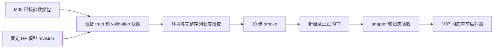

# 第 6 课：在 24GB 单卡上完成一次可追溯的 Qwen QLoRA 实验

本课对应 M06，目标是用 M05 的合成业务数据训练一个 LoRA adapter，并留下能解释、能复核的实验记录。产物包括固定训练输入、环境报告、完整日志和 adapter；业务效果是否改善留到 M07 用同一个 4B 底座做对照。

**执行位置：下面安装、下载、检查、WebUI 和训练命令都在 Ubuntu 24.04 服务器执行。** Windows 会话只编辑代码和文档。服务器安装与实机测试由另一个会话处理；本文不是服务器已验收的报告。

截至 2026-10-19，M04/M05 已经由 PR #3 合并，M06 尚待交付。先取得交付说明指定的 M06 提交，再执行命令；不要因这份文档存在就认定服务器已有相应代码。实际发布状态以后续交付记录为准。

已知硬件是 RTX 4090D 24GB、内存 128GB。此前提到的“CUDA 13”来自驱动显示、系统 Toolkit 还是其他环境，尚待核对；原 Ollama 标签 `qwen3.8:27b` 的底座身份也未确认。本课不依据该标签推断模型架构，不使用它的 GGUF 权重训练。

## 1. 先建立正确的实验模型

SFT（监督微调）让模型学习“输入请求 → 规范答案”的对应关系。本课答案沿用 M04 的四字段 JSON：`intent`、`customer_id`、`product_id`、`action`。库存量、工资、订单金额等动态业务事实仍由经过权限检查的应用查询，不写入训练答案。

| 术语 | 本课中的含义 |
|---|---|
| 底座模型 | 官方 HF 格式的 Qwen3-4B-Instruct-2507 |
| tokenizer | 把文本转换为 token ID 的规则和词表 |
| 聊天模板 | 在 system、user、assistant 之间加入模型识别的边界标记 |
| LoRA | 冻结主要权重，只训练少量低秩增量参数 |
| QLoRA | 以量化底座配合 LoRA 训练，减少底座权重占用 |
| NF4 | 本课 bitsandbytes 4bit 权重量化类型 |
| BF16 | 本课计算精度，不等于底座权重保存为 16bit |
| micro-batch | 一次前向/反向传播实际处理的样本数 |
| 梯度累积 | 多次 micro-batch 后才进行一次参数更新 |
| step | 本课日志和保存间隔主要指 optimizer 更新步 |
| epoch | 完整遍历一次训练区数据 |
| checkpoint | 某一步保存的 adapter 和训练恢复状态 |
| adapter | 依赖匹配底座使用的增量权重，不是独立完整模型 |

4bit 不意味着整个训练只占“参数量 × 半字节”的显存。激活、梯度、LoRA 参数、优化器和临时缓冲也要占空间；128GB 主存不能自动代替 24GB 显存。具体峰值与耗时必须实测，本文不给未经验证的保证。



## 2. 固定版本，理解验证边界

本课选择如下来源，候选版本记录在 `configs/training/m06-versions.json` 与 `requirements/m06-constraints.txt`：

| 项目 | 固定值 |
|---|---|
| Python | 3.11，记录实际补丁版本 |
| LLaMA-Factory | v0.9.4 |
| Factory Git SHA | `95ac3f2373b82662c1bd855c284d3379e6a763d3` |
| HF repo | `Qwen/Qwen3-4B-Instruct-2507` |
| HF revision | `cdbee75f17c01a7cc42f958dc650907174af0554` |
| 模板 | `qwen3_nothink` |
| torch / torchvision / torchaudio | 2.6.0+cu124 / 0.21.0 / 2.6.0 |
| transformers / peft / bitsandbytes | 4.57.1 / 0.17.1 / 0.46.1 |
| accelerate / datasets / trl | 1.11.0 / 4.0.0 / 0.24.0 |
| torchdata / gradio | 0.11.0 / 5.50.0 |

这是按上游源码约束选择的**核心候选组合**，不是完整传递依赖锁，也不是 GPU 实测认证。安装成功后保存 `pip freeze --all`，失败则保留实际解析冲突，不擅自逐个升级直到“能启动”。本课不安装 flash-attn 或 DeepSpeed，注意 `flash_attn: sdpa` 是配置字段，并非要求安装 flash-attn 包。

模型卡说明该 Instruct 版本是非思考模型；本课不添加 `<think>` 答案，也不把普通 Qwen3 的 thinking 模板混入。训练前阅读模型卡与许可，固定模型和 tokenizer 为同一个 revision。[官方模型卡](https://huggingface.co/Qwen/Qwen3-4B-Instruct-2507)

## 3. 检查代码、GPU 和磁盘

打开服务器 Bash 终端，先确认代码位置。示例项目目录沿用 M01；如你的目录不同，只修改第一行。

```bash
cd "$HOME/projects/enterprise-ai-agent-platform"
export PROJECT="$PWD"
git status --short --branch
git log -1 --format='%H %s'
ls src/enterprise_ai/training.py src/enterprise_ai/training_checks.py
ls requirements/m06-constraints.txt configs/training/m06-smoke.yaml
nvidia-smi
command -v nvcc && nvcc --version
df -h "$PROJECT" "$HOME"
```

`nvcc` 不存在可单独记录，不需要为了运行官方 PyTorch wheel 立即安装系统 Toolkit。`nvidia-smi` 的 CUDA Version 表示驱动能力，`nvcc --version` 表示系统 Toolkit，后续 `torch.version.cuda` 表示 PyTorch 编译对应的 CUDA runtime，三者可以不同。先记录真实值，再判断兼容问题，不能因为显示 13 就安装任意 cu13 包。

检查显存占用和进程归属；若 Ollama 或其他任务占用大量显存，先协调释放自己的任务，不直接杀死不明进程。给模型快照、下载缓存、多个 checkpoint 和日志留空间；实际需求以下载和训练产物为准。

下面所有步骤按顺序执行，任一必要步骤非零退出即停止。进入需要保存日志的阶段时启用 `set -o pipefail`，否则管道末端 `tee` 成功可能掩盖前面的训练失败。

## 4. 建立独立的 Python 3.11 环境

Ubuntu 24.04 默认 Python 3.12，M01 的 `.venv` 也可能是 3.12。M06 使用新的 `.venv-m06`，不能只在旧环境里安装训练包。主线假设你已经有可执行的 Python 3.11：

```bash
command -v python3.11
python3.11 --version
test ! -e "$PROJECT/.venv-m06" || { echo '环境已存在，请先核对来源'; exit 1; }
python3.11 -m venv "$PROJECT/.venv-m06"
. "$PROJECT/.venv-m06/bin/activate"
python -c 'import sys; print(sys.executable); print(sys.version); assert sys.version_info[:2] == (3, 11)'
python -m pip --version
```

如第一步找不到 3.11，停止主线。可让安装会话配置独立 Python，或采用 uv 官方路线；不替换 `/usr/bin/python3`，不假定 Ubuntu 默认仓库一定提供 `python3.11-venv`。

**备用路线，仅在尚未创建 `.venv-m06` 时使用：** 先按 [uv 官方安装说明](https://docs.astral.sh/uv/getting-started/installation/)安装并核对 `uv --version`；没有 uv 时不要直接执行下一块。uv 使用的托管 Python 发行来源也应写入环境记录。[uv Python 管理说明](https://docs.astral.sh/uv/guides/install-python/)

```bash
uv --version
uv python install 3.11
test ! -e "$PROJECT/.venv-m06" || { echo '环境已存在'; exit 1; }
uv venv --python 3.11 --seed "$PROJECT/.venv-m06"
. "$PROJECT/.venv-m06/bin/activate"
python -c 'import sys; print(sys.executable); print(sys.version); assert sys.version_info[:2] == (3, 11)'
python -m pip --version
```

两条路线选一条。后续始终用 `python -m pip`，避免系统 pip 和当前 Python 指向不同环境。不要使用 `sudo pip`。

## 5. 安装固定 Factory 和候选依赖

先创建本次安装记录目录，后面日志只写入这个新目录。把示例 `01` 改成未使用编号；若重开终端，需要重新激活环境并恢复 `PROJECT`、`EVIDENCE`、`FACTORY` 等变量。

```bash
umask 077
export EVIDENCE="$PROJECT/reports/local/m06-install-01"
test ! -e "$EVIDENCE" || { echo '记录目录已存在'; exit 1; }
mkdir -p "$EVIDENCE"
export FACTORY="$HOME/tools/LLaMA-Factory-v0.9.4-m06"
test ! -e "$FACTORY" || { echo 'Factory 目录已存在，请核对后换新目录'; exit 1; }
mkdir -p "$HOME/tools"
git clone --branch v0.9.4 --depth 1 https://github.com/hiyouga/LLaMA-Factory.git "$FACTORY"
test "$(git -C "$FACTORY" rev-parse HEAD)" = '95ac3f2373b82662c1bd855c284d3379e6a763d3' || exit 1
git -C "$FACTORY" status --short
```

HEAD 必须匹配，工作区应无意外修改。先从 PyTorch 官方 cu124 索引安装 torch 三件套；此安装命令对应官方历史版本说明。[PyTorch 2.6.0 安装来源](https://pytorch.org/get-started/previous-versions/)

```bash
set -o pipefail
python -m pip install torch==2.6.0 torchvision==0.21.0 torchaudio==2.6.0 \
  --index-url https://download.pytorch.org/whl/cu124 \
  2>&1 | tee "$EVIDENCE/install-torch.log" || exit 1
```

再装候选核心依赖与两个 editable 项目：

```bash
set -o pipefail
python -m pip install \
  -r "$PROJECT/requirements/m06-constraints.txt" \
  -c "$PROJECT/requirements/m06-constraints.txt" \
  -e "$FACTORY" -e "$PROJECT" \
  2>&1 | tee "$EVIDENCE/install-training.log" || exit 1
python -m pip check 2>&1 | tee "$EVIDENCE/pip-check.txt" || exit 1
python -m pip freeze --all > "$EVIDENCE/pip-freeze-all.txt" || exit 1
python -m enterprise_ai.training --help
python -m enterprise_ai.training_checks --help
```

这里 `-r` 真正要求安装列表中的包，`-c` 限制依赖解析所用版本。只写 `-c` 不会保证可选的 bitsandbytes 被安装。第二步也要保留已安装的 cu124 torch；后续 preflight 会精确核对 `2.6.0+cu124`。若解析器报告不兼容，保留日志交给测试会话，不移除约束或设置跳过版本检查的开关。

`pip check` 只检查包声明的依赖关系，不证明 CUDA 算子可用。`pip freeze` 是这次实际解析结果的记录，不自动成为跨机器通用锁文件。

## 6. 执行服务器 preflight

报告输出路径必须不存在；工具使用独占创建，失败也尽量保留 JSON。下面会运行一个很小的 NF4 线性层前向/反向检查，不下载或加载 4B 模型。

```bash
python -m enterprise_ai.training_checks preflight \
  --factory-dir "$FACTORY" \
  --output "$EVIDENCE/preflight.json" || exit 1
python -m json.tool "$EVIDENCE/preflight.json"
```

检查 `status`、`errors`、`packages`、Factory SHA 与实际导入信息、GPU 名称/显存、`cuda_version`、`bf16_supported`、`nf4_forward_backward`。Factory 应为 0.9.4，实际导入路径应来自指定 checkout，`tracked_clean` 应为 true；只检查传入目录的 Git HEAD 不能证明 Python 实际用了它。预期 CUDA runtime 为 12.4，错误列表为空；这是验收目标，不是预先写好的实测结果。

preflight 检查核心训练包（包括 Gradio 5.50.0），不覆盖全部传递依赖或 WebUI 的完整行为；同时保留 freeze 和约束文件。`passed` 仅意味着本工具覆盖的环境检查通过。它不能证明模型权重完整可信、真实 tokenizer 兼容、数据加载正确或训练能装入显存。Factory 源码应保持干净，检查后也不能临时修改它。

## 7. 下载固定的 HF 模型快照

使用新的模型目录；模型下载只在服务器执行。不要将现有 Ollama blob、GGUF 或其他型号文件复制到此目录冒充 HF 快照。

```bash
export MODEL_DIR="$HOME/models/Qwen3-4B-Instruct-2507-cdbee75"
test ! -e "$MODEL_DIR" || { echo '模型目录已存在，请先核对下载记录'; exit 1; }
set -o pipefail
python - <<'PY' 2>&1 | tee "$EVIDENCE/model-download.log" || exit 1
import json
import os
from pathlib import Path
from huggingface_hub import snapshot_download

repo = 'Qwen/Qwen3-4B-Instruct-2507'
revision = 'cdbee75f17c01a7cc42f958dc650907174af0554'
path = snapshot_download(repo_id=repo, revision=revision, local_dir=os.environ['MODEL_DIR'])
record = {'repo_id': repo, 'revision': revision, 'local_dir': str(Path(path).resolve())}
with (Path(os.environ['EVIDENCE']) / 'model-download.json').open('x', encoding='utf-8') as stream:
    json.dump(record, stream, ensure_ascii=False, indent=2)
print(json.dumps(record, ensure_ascii=False, indent=2))
PY
```

`snapshot_download` 支持完整 revision 与 `local_dir`，下载记录只在函数成功返回后写出。网络中断时保留部分下载和日志；由安装会话在确认同一个 repo、revision、目录后恢复下载，不删除现场。[HF 官方下载说明](https://huggingface.co/docs/huggingface_hub/guides/download)

本课下载公开模型不在命令里嵌入 token。若网络环境需要认证，使用正式的本机凭证配置，交接时删除 token、代理密码和带凭证的 URL。

准备器只检查 `model_type=qwen3`、非空 tokenizer JSON、safetensors 索引和所引用非空分片，并记录 config 摘要。**它不解析全部权重、不计算权重文件摘要、不证明真实参数量或官方来源。** manifest 中 `expected_revision` 是期望值，不是读取权重后得到的认证。来源证据要结合上述下载记录、固定 revision 和实际模型加载结果。

## 8. 复核 M05，准备 smoke 输入

M05 人工抽样结论必须另行查看；自动校验器不会替人宣布审核完成。先验证原包，随后准备器还会复制并验证自己捕获的那份完整源快照，再导出训练与验证区。

```bash
cd "$PROJECT"
export DATA="$PROJECT/data/generated/m05-v1"
python -m enterprise_ai.finetune_data validate "$DATA" \
  --baseline-cases "$PROJECT/data/samples/m04-intents.jsonl" || exit 1
export RUN="$PROJECT/reports/local/m06-smoke-01"
python -m enterprise_ai.training prepare \
  --data "$DATA" --model-dir "$MODEL_DIR" \
  --run-dir "$RUN" --profile smoke \
  --baseline-cases "$PROJECT/data/samples/m04-intents.jsonl" || exit 1
python -m enterprise_ai.training verify --run-dir "$RUN" || exit 1
```

`RUN` 必须是不存在的新目录，不要提前 `mkdir "$RUN"`。smoke 选训练区前 64 条、验证区前 32 条，保持每组 16 条的边界；正式 sft 使用全部 336/96 条。prepare 不会下载模型或启动训练。

```text
reports/local/m06-smoke-01/
  manifest.json             # prepared 状态、来源摘要、模型路径、输入摘要
  train.yaml                # 路径已经解析为服务器绝对路径
  data/
    train.json              # 64 条
    validation.json         # 32 条
    dataset_info.json       # 只注册 m06_train / m06_validation
  adapter/                  # prepare 不创建；训练才产生
```

M05 test 文件可能参与原包完整性校验，但不会复制到 run/data、注册训练或参与 tokenizer 长度检查。不得用 test 选超参数或 checkpoint。

`train.yaml` 使用 JSON 写法，它同时是合法 YAML，方便标准库读取。manifest 从 `preparing` 变为 `prepared` 才表示准备完成；`prepared` 不表示训练完成。若失败留下半成品目录，保留并使用新 run 修复重做。

`verify` 会比较输入摘要、样本数、注册表、模型 config 和当前配置模板。它允许训练日志和 adapter 共存，但不验证这些训练结果。不要手改已经准备好的 `train.yaml`、数据或 manifest；也不要移动 run 后继续使用其中的旧绝对路径。

## 9. 用真实 tokenizer 检查完整序列

```bash
python -m enterprise_ai.training_checks token-lengths \
  --run-dir "$RUN" --output "$RUN/token-lengths.json" || exit 1
python -m json.tool "$RUN/token-lengths.json"
```

检查器只读取本地 tokenizer，要求固定 Factory SHA，按 `qwen3_nothink` 计算 system + 用户请求 + 答案 + 模板特殊标记的未截断长度。字符数、中文汉字数都不能替代 token 数。

通过条件是 train/validation 数量正确，`over_cutoff_indices` 和 `empty_answer_indices` 均为空，`errors` 为空。报告的 `checked_artifacts` 记录实际捕获并校验的配置/数据字节快照摘要；结果只适用于那份快照，不能证明文件之后没有变化。索引从 0 开始；出错时按报告回查对应区样本，不要去翻 test 找“相似正确答案”。

长度通过仍不代表实际 Factory loader 已通过。启动 smoke 后还要核对它实际读取的训练/验证数量、样例中的 system 与 assistant 边界，以及是否有样本被过滤或意外截断。

## 10. 理解配置中的关键参数

两种配置都由 `configs/training/` 模板生成。先看生成的 `train.yaml`，不要凭 WebUI 默认值复现。

| 参数 | smoke / sft | 为什么这样设置 |
|---|---|---|
| stage / finetuning_type | sft / lora | 训练任务与可训练参数方式 |
| template | qwen3_nothink | 匹配固定非思考底座 |
| quantization_method / bit / type | bnb / 4 / nf4 | 量化底座权重 |
| double_quantization | true | 进一步量化量化统计量 |
| lora_target | all | 由固定版本 Factory 选择适用线性层 |
| lora_rank / alpha / dropout | 8 / 16 / 0.05 | 容量、缩放与正则化参数 |
| cutoff_len | 2048 / 2048 | 完整序列长度上限 |
| packing / neat_packing | false / false | 保持单条样本边界，便于教学检查 |
| train_on_prompt | false | 不把用户和 system 文本当作目标答案学习 |
| mask_history | false | 本课单轮数据，没有历史轮次需要遮蔽 |
| per_device_train_batch_size | 1 / 1 | 降低一次计算的激活显存 |
| gradient_accumulation_steps | 4 / 8 | 等效单卡批量分别为 4 / 8 |
| gradient_checkpointing | true | 以重算换取较少激活存储 |
| flash_attn | sdpa | 使用 PyTorch SDPA 路线 |
| bf16 / fp16 | true / false | 只启用 BF16 |
| learning_rate | 0.0001 / 0.0001 | LoRA 参数更新幅度 |
| lr_scheduler_type / warmup_ratio | cosine / 0.1 | 预热后按余弦降低学习率 |
| max_steps / num_train_epochs | 10 / 3 | smoke 固定步数，sft 固定轮次 |
| eval_steps / save_steps | 5 / 42 | 评估与 checkpoint 间隔 |
| logging_steps | 1 / 5 | loss 等训练指标记录频率 |
| save_total_limit | 2 | 限制周期 checkpoint 数量，不代表全部目录只留两文件 |
| save_only_model | false | 保留优化器等恢复材料 |
| overwrite_output_dir | false | 避免显式覆盖，但不能阻止上游自动恢复 |
| report_to | none | 不向外部实验平台主动上报 |
| seed / data_seed | 42 / 42 | 固定随机种子，不能保证不同 GPU 上逐位一致 |

smoke 的 10 步是 10 次参数更新，不是 10 条样本，也不是 10 个 epoch。正式单卡每轮约 `336 ÷ (1 × 8) = 42` 次更新，3 轮预计 126 步。若实际日志不同，先核对样本过滤、设备数、batch、累积和配置，不为了凑 126 手改日志。

固定 `eval_dataset=m06_validation`，不使用正数 `val_size` 随机切分。配置未启用自动选择最佳 checkpoint；最终 adapter 不能自动称为“验证集最佳模型”。检查点选择规则应先约定、仅看 validation，并记录选择依据。

## 11. 可选：用 WebUI 学习字段，只预览

CLI 是本课正式训练的唯一执行路线。WebUI 用来认识字段、查看数据选择与预览生成参数，**本课不点击开始训练**。固定 v0.9.4 的 UI 默认可能生成 `trust_remote_code=true`、额外 `max_samples`、自己的输出目录，并在正数验证比例时重新切分；额外参数还可能被后续 UI 字段覆盖，不能只粘贴一段 JSON 就认为与准备文件等价。[v0.9.4 参数生成源码](https://github.com/hiyouga/LLaMA-Factory/blob/v0.9.4/src/llamafactory/webui/runner.py)

在另一个服务器终端激活同一 `.venv-m06`，运行下面命令；确认没有其他进程占用 7860。v0.9.4 读取 `GRADIO_SERVER_NAME` 与 `GRADIO_SHARE`，这里明确只绑定回环且不共享公网链接。[v0.9.4 WebUI 启动源码](https://github.com/hiyouga/LLaMA-Factory/blob/v0.9.4/src/llamafactory/webui/interface.py)

```bash
cd "$HOME/projects/enterprise-ai-agent-platform"
. .venv-m06/bin/activate
GRADIO_SERVER_NAME=127.0.0.1 GRADIO_SERVER_PORT=7860 GRADIO_SHARE=0 \
  llamafactory-cli webui
```

在你自己的电脑上建立 SSH 隧道，把占位值改成已配置的服务器账号和地址：

```bash
ssh -N -L 7860:127.0.0.1:7860 YOUR_USER@YOUR_SERVER
```

然后本机打开 `http://127.0.0.1:7860`，根据服务启动日志核对实际端口。若端口不同，统一修改服务端和隧道端口，不将服务改绑 `0.0.0.0` 来绕过连接问题。

| UI 字段含义 | 对应 CLI 配置 | 预览时核对 |
|---|---|---|
| 模型路径 | model_name_or_path | 固定 HF 本地绝对路径 |
| 微调方法 | finetuning_type | lora |
| 检查点路径 | adapter_name_or_path 等 | 首次训练留空，不加载旧 adapter |
| 量化位数/方法 | quantization_bit / quantization_method | 4 / bnb |
| 对话模板 | template | qwen3_nothink |
| 数据路径/数据集 | dataset_dir / dataset | run/data 与 m06_train |
| 验证比例 | val_size | 0；固定验证集需要显式 eval_dataset |
| 截断长度/批大小/累积 | cutoff_len / batch / accumulation | 与 train.yaml 一致 |
| 计算类型 | bf16 / fp16 | BF16，不能两者都启用 |
| LoRA rank/alpha/dropout | 同名配置 | 8 / 16 / 0.05 |
| 优化与保存字段 | learning_rate / save_steps 等 | 按 smoke 或 sft 逐项核对 |
| 输出目录 | output_dir | UI 可能加工路径，不能根据输入框猜最终目录 |

点击预览后逐项比较命令与 `train.yaml`，记录不一致点。预览成功并不证明数据加载或模型加载成功；不要将 UI 配置文件覆盖准备器的训练配置。记录完关闭 WebUI，再回到下面 CLI 路线。

## 12. 执行 10 步 smoke

训练前再跑一次输入 verify。在**同一个命令块**检查 `adapter` 不存在，然后启动；这是必要的首次运行保护。上游 v0.9.4 在输出目录已有 checkpoint 时可能自动设置 resume，即使配置没有写 `resume_from_checkpoint`。[上游解析源码](https://github.com/hiyouga/LLaMA-Factory/blob/v0.9.4/src/llamafactory/hparams/parser.py)

```bash
python -m enterprise_ai.training verify --run-dir "$RUN" || exit 1
test ! -e "$RUN/adapter" || { echo 'adapter 已存在，禁止当作首次训练重跑'; exit 1; }
test ! -e "$RUN/train.log" || { echo '日志已存在，请保留并核对旧实验'; exit 1; }
set -o pipefail
llamafactory-cli train "$RUN/train.yaml" 2>&1 | tee "$RUN/train.log"
TRAIN_EXIT=$?
printf '%s\n' "$TRAIN_EXIT" > "$RUN/train.exit-code"
test "$TRAIN_EXIT" -eq 0 || { echo '训练失败，保留现场并停止'; exit "$TRAIN_EXIT"; }
```

不要并发启动同一个 run。训练开始时核对模型路径、量化方式、可训练参数比例、训练/验证条数；出现远程代码提示、意外模型下载、数量不符或其他底座时停止诊断。另开服务器终端观察 GPU：

```bash
nvidia-smi -l 2
```

记录采样所见最大显存、实际耗时、训练 loss、两次评估结果和最后更新步。`nvidia-smi` 采样峰值可能漏掉瞬时峰值，报告时标注采样方式。不要用 smoke 的短期曲线判断业务改进。

smoke 验收要求：实际退出码 0；日志完成 10 更新步；训练 64、验证 32 的加载证据一致；loss/eval_loss 为有限值；保存了 adapter 和预期 checkpoint；没有不明截断、跳样或 OOM。缺任一证据都先停在 smoke，不直接扩成正式训练。

## 13. 新建正式 SFT run

smoke 通过后新建目录，使用同一固定底座重新开始，**不把 smoke adapter 当成正式训练起点**。这样“3 个 epoch”的定义清楚，两个实验也不混用状态。

```bash
export RUN="$PROJECT/reports/local/m06-sft-01"
python -m enterprise_ai.training prepare \
  --data "$DATA" --model-dir "$MODEL_DIR" \
  --run-dir "$RUN" --profile sft \
  --baseline-cases "$PROJECT/data/samples/m04-intents.jsonl" || exit 1
python -m enterprise_ai.training verify --run-dir "$RUN" || exit 1
python -m enterprise_ai.training_checks token-lengths \
  --run-dir "$RUN" --output "$RUN/token-lengths.json" || exit 1
```

检查 manifest 的 336/96 数量和新的绝对输出路径。然后执行首次正式训练保护块：

```bash
python -m enterprise_ai.training verify --run-dir "$RUN" || exit 1
test ! -e "$RUN/adapter" || { echo 'adapter 已存在，禁止当作首次训练重跑'; exit 1; }
test ! -e "$RUN/train.log" || { echo '日志已存在'; exit 1; }
set -o pipefail
llamafactory-cli train "$RUN/train.yaml" 2>&1 | tee "$RUN/train.log"
TRAIN_EXIT=$?
printf '%s\n' "$TRAIN_EXIT" > "$RUN/train.exit-code"
test "$TRAIN_EXIT" -eq 0 || { echo '训练失败，保留现场并停止'; exit "$TRAIN_EXIT"; }
```

预计在 42、84、126 步评估与保存，最终步数以真实 loader 和 Trainer 日志为准。没有 GPU 实测前不承诺耗时。训练中不要更新 editable Factory 或项目代码，不改变当前环境、数据和模型目录。

## 14. 如何读结果与检查产物

| 观察 | 能说明什么 | 下一步 |
|---|---|---|
| train loss 下降，eval_loss 也下降 | 对相应目标 token 的拟合改善 | 到 M07 检查输出契约与业务错误 |
| train loss 降，eval_loss 持续上升 | 可能过拟合或分区难度不同 | 检查数据、轮次与验证样例，保留曲线 |
| 两者不变或很高 | 可能学习不足、模板或目标有误 | 先查样例/标签，再考虑超参数 |
| loss 出现 NaN/Inf | 数值异常或训练异常 | 停止验收，保留首次异常前后日志 |
| loss 很低但 JSON 多字段/多解释 | token 平均损失不能代表严格契约成功 | 用实际生成评估定位问题 |

eval_loss 是验证答案的平均 token 损失，不能直接换算为“业务准确率 98%”。样本长短、模板和 token 计数会影响平均值；不要比较不同底座、不同提示词的 loss 来证明 LoRA 收益。

查看实际文件，下面只是列出与验证，不加载权重：

```bash
python -m enterprise_ai.training verify --run-dir "$RUN" || exit 1
find "$RUN/adapter" -maxdepth 2 -type f -printf '%P\n' | sort
python -m json.tool "$RUN/adapter/adapter_config.json"
```

通常应看到 `adapter_config.json`、`adapter_model.safetensors`、训练状态/结果 JSON 和 `checkpoint-*` 目录；具体文件以实际版本输出为准。checkpoint 中优化器、调度器和随机状态用于恢复。保存数量上限可能清理较早 checkpoint，不能假定每个历史步都永久存在。

仅“文件存在”还不够：保存命令退出 0、权重文件非空、LoRA 配置符合预期、日志终点和评估记录一致，并在 M07 成功加载匹配底座与 adapter，证据才逐步完整。备份时保留底座下载来源、run 输入、环境报告与 adapter 的对应关系，不只复制一个 safetensors 文件。

## 15. 故障排查与恢复边界

| 症状 | 先检查 | 处理边界 |
|---|---|---|
| No module named enterprise_ai | 当前目录、Python 路径、editable 安装 | 不安装同名第三方包 |
| Python 版本检查失败 | 是否误激活 M01 的 3.12 环境 | 切回独立 3.11，不在旧环境硬改 |
| pip 解析失败 | 完整安装日志和 constraints | 交接冲突，不盲目升级 |
| CUDA 不可用 | 驱动、GPU 可见性、torch 实际 wheel | 修环境后用新报告重跑 preflight |
| NF4 probe 失败 | bnb/torch 版本、CUDA runtime、错误类型 | 小探针失败时不加载 4B 试运气 |
| 模型结构检查失败 | 分片、索引、目录类型、下载记录 | 固定 revision 恢复下载；不能换 GGUF |
| token 长度超限 | 报告中的 split 和 0-based index | 检查全序列，不静默截掉答案 |
| run 或报告已存在 | 是成功记录还是中断现场 | 使用新编号，保留旧目录 |
| 输入 digest mismatch | 数据、配置、路径或模板是否变动 | 回到明确代码版本，不重写摘要绕过 |
| CUDA out of memory | GPU 其他任务、序列长度、日志所在阶段 | 保留失败记录，按下文新实验处理 |
| NaN/Inf | 首次异常步、BF16、输入与学习率 | 不把保存出的 adapter 标为可用 |
| SSH 断开 | 进程是否仍在运行、日志是否增长 | 先确认状态，不再开一个相同任务 |
| WebUI 连不上 | 服务日志、回环监听端口、SSH 隧道 | 不开放公网端口作为捷径 |

OOM 时当前 micro-batch 已是 1；单纯增加梯度累积不会降低一次前向的激活峰值。先查其他 GPU 任务，再考虑缩短 cutoff、调整 LoRA 容量等，并解释这会如何影响任务。不要以删除验证集或把 test 合入训练来“解决”内存。

**改变参数的正确边界：** 保留失败 run、Git SHA、原模板副本和变更说明；在代码层修改相应配置模板并记录新版本，重新 prepare 到新 run，重新 verify 和 token-lengths，再做 smoke。不要直接编辑已 prepared 的 train.yaml。当前验证器会与当前模板比较，因此模板变更后旧 run 需要用它对应的旧代码版本复核，不要把这种不匹配误判为旧数据损坏。

**中断恢复：** `overwrite_output_dir=false` 不等于禁止自动 resume。先确认旧进程已经退出，检查 checkpoint 是否完整，并核对原底座 revision、数据与配置摘要、Factory/包版本、优化器状态和日志最后步数。加载 adapter 继续训练也不等价于恢复 optimizer/scheduler 状态。

本课首次运行块故意拒绝已有 adapter；不要删除 guard 后直接重跑。复杂恢复交给服务器测试会话制定单独方案，明确从哪个 checkpoint、目标总步数、恢复日志位置及结果命名。若决定从头重做，prepare 新 run，旧目录保留；不提供绕过这些检查的通用“安全恢复一行命令”。

## 16. 验收清单与 M07 交接

| 层级 | 所需证据 | 不能据此宣称 |
|---|---|---|
| 代码与输入 | 固定提交、M05 validate、prepare/verify、人工审核记录 | GPU 训练已通过 |
| 环境 | pip check、freeze、preflight JSON | 4B 已可训练 |
| tokenizer | token-lengths JSON、数量与超限检查 | Factory loader 已通过 |
| smoke | 64/32 实际加载、10 步、有限损失、退出码和产物 | 正式训练或业务收益已通过 |
| 正式 SFT | 336/96、预计 126 步的实际记录、评估日志、adapter | 模型比底座更好 |
| M07 | 同 4B 底座与其 adapter 的固定题集生成对照 | 全部企业真实场景泛化 |

M07 保持底座、revision、提示词、解码配置和冻结题集一致，分别评估未加 adapter 与加 adapter 的结果；检查 JSON 合法率、四字段精确匹配、拒绝/澄清错误和业务类别表现。原 Ollama 27B 可作为另一个系统参考，不能把它与 4B 的分数差直接归因为微调。

使用[跨会话运行手册](../runbooks/m06-server-handoff.md)提交结果。只填写真实执行的项目，未运行写“待验证”，失败写实际退出码与首个错误。不要复制 `.env`、访问 token 或整份包含凭证的环境变量。

## 17. 练习与参考答案

1. `nvidia-smi` 显示 CUDA 13，而 preflight 记录 torch runtime 12.4，是否必然冲突？
2. 仅运行 `pip install -c constraints.txt -e Factory`，能保证 bitsandbytes 已安装吗？
3. smoke 的 10 step、batch 1、累积 4，是否代表只看过 10 条训练样本？
4. 训练 loss 降至 0.1，可以写“意图准确率 90%”吗？
5. 原目录有 checkpoint，配置没有 resume 字段，能直接重跑吗？
6. OOM 后把 run/train.yaml 的 cutoff 改成 1024，是否符合本课输入追踪规则？
7. prepare 的模型检查通过，是否证明下载的权重就是官方 4B revision？
8. 为什么 validation 可以看，而 test 不能反复用来选 checkpoint？
9. 对比 Ollama 27B 与微调 4B，分数提高能否称为 LoRA 收益？
10. NF4 小探针与 token 长度都通过，下一步能直接宣布正式训练完成吗？

参考答案：

1. 不一定。它们分别描述驱动能力与 PyTorch runtime；记录来源，结合实际 GPU 算子检查判断。
2. 不能。constraints 只限制选择，不要求安装每个包；本课同时使用 `-r` 与 `-c`。
3. 不是。每次更新累积多个 micro-batch，10 步约处理 40 个样本位置；实际还取决于采样/迭代行为，不能把它当作完整 epoch。
4. 不能。loss 是目标 token 的损失，业务精确匹配必须实际生成并按契约评估。
5. 不能。固定版本上游可能自动发现 checkpoint 并恢复；首次运行必须检查 adapter 目录不存在。
6. 不符合。应记录模板变更，prepare 新 run，重新检查长度；旧现场保留。
7. 不能。检查只证明限定的目录结构与 config 条件，未认证权重内容与来源。
8. validation 用于开发与选择；反复依据 test 调整方案会让 test 变成开发数据，破坏独立评价。
9. 不能。底座大小、量化、模板等同时变化；应对同一个 4B 底座做有/无 adapter 对照。
10. 不能。还需要真实 loader、10 步 smoke、正式训练、产物和日志证据，业务收益另由 M07 验证。
