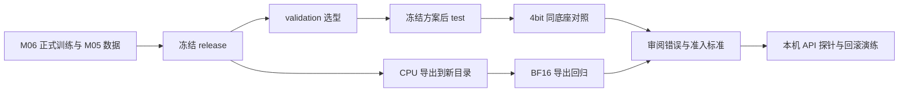

# 第 7 课：评估微调效果、导出模型并验证服务

本课对应 M07。你将回答三个不同的问题：同一个 4B 底座加上 adapter 后是否更符合业务输出要求；导出重载是否改变行为；本机 API 是否具备最小鉴权和响应契约。

**执行位置：本课所有命令在 Ubuntu 服务器运行。** Windows 仅完成代码、测试替身和文档检查，没有训练、导出或模型效果成绩。先取得包含本章的 `codex/m07-evaluation-serving` 分支或后续合并提交；发布状态以 GitHub PR 为准。M06 PR #4 与本章可能尚未进入 main。

前置：[第 5 课](05-finetune-data.md)的数据审核、[第 6 课](06-qwen-finetuning.md)的真实训练和 adapter 验收。若没有完成真实训练，可先阅读原理；不能拿测试里的伪权重执行本章。记录模板见 [M07 运行手册](../runbooks/m07-model-delivery.md)。

## 1. 先区分两组实验

| 问题 | before | after | 可以得出的结论 |
| --- | --- | --- | --- |
| 微调是否改善 | `base`：4bit NF4 底座 | `adapter`：同一 4bit 底座 + LoRA | 固定合成题集上的微调前后变化 |
| 导出是否回归 | `adapter-bf16`：BF16 运行时加载 adapter | `merged`：CPU 导出后 BF16 重载 | 导出保存与重载路径的行为差异 |

不要拿 4bit 与 BF16 的差异解释为 LoRA 收益，也不要与原 Ollama 27B 的分数直接相减。本课固定 Qwen3-4B-Instruct-2507、M06 revision、`qwen3_nothink`、greedy、seed 42、输出最多 256 token、总预算 2048 token。

LF v0.9.4 的非量化 LoRA 推理可能运行时合并 adapter，所以第二组不是“独立未合并 PEFT 与合并模型”的数学等价证明。固定版本接口见 [ChatModel](https://github.com/hiyouga/LLaMA-Factory/blob/v0.9.4/src/llamafactory/chat/chat_model.py) 与 [adapter 加载逻辑](https://github.com/hiyouga/LLaMA-Factory/blob/v0.9.4/src/llamafactory/model/adapter.py)。



## 2. 理解分区与指标

M05 有 train 336、validation 96、test 48 条。训练区只用于训练；validation 可选 checkpoint、修改提示词或决定是否继续训练。**方案冻结后才运行 test**；看到 test 错题后再调参，会污染这次测试结论，应另建独立保留集。

本课任务是输出 `intent/customer_id/product_id/action` 四字段 JSON，不查询真实假期或库存，也不代替数据库权限判断。复用 M04 `SYSTEM_PROMPT` 和评分器，不额外启用 JSON 约束解码，以免把协议限制当作微调收益。

| 指标 | 含义 | 诊断方向 |
| --- | --- | --- |
| JSON 合法率 | 可严格解析的回答 / 全部选中题目 | 多余解释、截断、重复 JSON key |
| schema 合法率 | 四字段与类型符合约定 / 全部选中题目 | 多字段、ID 类型、未知枚举 |
| 字段准确率 | 某字段正确 / 全部选中题目 | 意图、编号、拒答或澄清规则 |
| exact match | 四字段全部正确 / 全部选中题目 | 总体契约正确性 |
| refusal_false_accepts | 预期拒答却输出 `action=query` 的次数 | 需逐条审阅的误放行 |
| latency_seconds | 本地请求耗时的均值、p50、p95 | 同硬件下辅助观察，不含模型初始化 |

生成异常与未执行题目都计入分母，不能删掉后重新算好看的分数。首次异常后停止继续请求，剩余题目标记 `not_executed`；失败运行不能正式比较。`finish_reason=length` 即便 JSON 能解析，也不计业务正确。错误回答本身不是进程失败：它是需要保留的实验结果。

`refusal_false_accepts=0` 不等于安全：无效 JSON、截断、错误澄清和其他错误需要一起看。合成测试集的高分也不能证明对真实客户数据泛化。

## 3. 恢复环境并核对训练产物

先完成第 6 课安装，不在本章升级依赖。按实际目录调整下面变量；不要指向 smoke run。

```bash
cd "$HOME/projects/enterprise-ai-agent-platform"
export PROJECT="$PWD"
. .venv-m06/bin/activate
export FACTORY="$HOME/tools/LLaMA-Factory-v0.9.4-m06"
export DATA="$PROJECT/data/generated/m05-v1"
export RUN="$PROJECT/reports/local/m06-sft-01"
export ADAPTER="$RUN/adapter"
export RELEASE="$PROJECT/reports/local/m07-release-01"
git status --short --branch
git log -1 --format='%H %s'
python -m pip check || exit 1
python -m enterprise_ai.training verify --run-dir "$RUN" || exit 1
test "$(cat "$RUN/train.exit-code")" = 0 || exit 1
test -s "$ADAPTER/adapter_model.safetensors" || exit 1
python -m enterprise_ai.training_checks preflight \
  --factory-dir "$FACTORY" --output "$PROJECT/reports/local/m07-preflight-01.json" || exit 1
```

若选择中间 checkpoint，将 `ADAPTER` 改为该 run 的 `adapter/checkpoint-实际步数`，并记录选择理由。准备器检查归属和结构，但不能证明训练真实成功、权重可信或 loss 正常；仍需审阅训练日志。

## 4. 创建不可覆盖的交付输入

```bash
python -m enterprise_ai.model_delivery prepare \
  --training-run "$RUN" --data "$DATA" --adapter-dir "$ADAPTER" \
  --output "$RELEASE" || exit 1
python -m enterprise_ai.model_delivery verify --release "$RELEASE" || exit 1
python -m json.tool "$RELEASE/manifest.json"
```

不要提前创建 `RELEASE`。工具捕获并校验 M05 快照，检查它与 M06 的来源摘要一致，再导出 96/48 条评估题；不把训练区带入 release。大型模型文件按块计算 SHA256，可能需要几分钟及大量磁盘读取。

| 自动生成的文件 | 用途 |
| --- | --- |
| `manifest.json` | 来源摘要、资产路径与指纹、题数、生成参数、准备状态 |
| `cases-validation.jsonl` / `cases-test.jsonl` | 固定题目、类别、输入和期望答案 |
| `base.yaml` / `adapter.yaml` | 4bit 对照配置，仅 adapter 路径不同 |
| `adapter-bf16.yaml` / `merged.yaml` | BF16 导出回归配置 |
| `export.yaml` | CPU、非量化底座合并配置 |

这些 `.yaml` 文件使用合法 JSON 语法，便于标准库读取，也可供 LF 加载。`num_return_sequences=1` 保存在生成契约并作为 chat 调用参数传入；LF v0.9.4 的配置 dataclass 不接受该字段，因此不会写入 YAML。路径是服务器绝对路径；搬迁后应重新 prepare，不手改 manifest。哈希是变化检测和版本指纹，不是来源认证或数字签名。模型目录不能同时包含单文件 `model.safetensors` 与分片索引，否则不同加载优先级可能造成指纹遗漏，工具会直接拒绝。不要在校验与加载之间修改资产；不运行并发训练覆盖同一 adapter。

## 5. 先验证两题管线，再执行完整 validation

停止上一轮训练、WebUI、API 等占用同一 GPU 的进程；一次只加载一个变体。每次 CLI 结束后进程退出，避免两个模型同时挤占 24GB 显存。

```bash
python -m enterprise_ai.model_eval evaluate \
  --release "$RELEASE" --variant base --split validation \
  --limit 2 --output "$RELEASE/smoke-base"
SMOKE_EXIT=$?
test "$SMOKE_EXIT" -eq 2 || { echo "预期子集退出码 2，实际 $SMOKE_EXIT，请检查"; exit 1; }
python -m json.tool "$RELEASE/smoke-base/summary.json"
python -m json.tool "$RELEASE/smoke-base/manifest.json"
```

**退出码 2 也可能表示失败**，不能仅看退出码就认定试跑成功。应确认 manifest 为 `completed`、`request_errors=0`、`identity_stable=true`、`is_subset=true`；`comparison_eligible=false` 是子集的预期结果。

```bash
python -m enterprise_ai.model_eval evaluate \
  --release "$RELEASE" --variant base --split validation \
  --output "$RELEASE/validation-base" || exit 1
python -m enterprise_ai.model_eval evaluate \
  --release "$RELEASE" --variant adapter --split validation \
  --output "$RELEASE/validation-adapter" || exit 1
python -m enterprise_ai.model_eval compare \
  --before "$RELEASE/validation-base" --after "$RELEASE/validation-adapter" \
  --output "$RELEASE/validation-comparison.json" || exit 1
```

每次评估保存 manifest、原始 `source-cases.jsonl`、选中 `cases.json`、逐题 `records.jsonl`、`summary.json`。比较器核对题目、参数、环境、代码和资产身份，并从原始回答重算分数。缺行、重复题号、摘要不符、子集、运行错误、不同精度或不同配置都会拒绝比较。

真实后端延迟加载固定 LF，记录 Python、包版本、Factory 来源及代码指纹。真实模板编码后检查 `prompt_tokens + 256 <= 2048`，超过就报错，不悄悄截断。LF 的结束原因依赖 EOS；本章要求模板停止 token 与 tokenizer EOS 一致，否则停止并保留错误。参考 [固定 HF 推理实现](https://github.com/hiyouga/LLaMA-Factory/blob/v0.9.4/src/llamafactory/chat/hf_engine.py)。

## 6. 冻结方案后执行 test，并解释结果

在运行手册中记录最终 checkpoint、选型理由、提示词及准入标准。不要为了通过验收反复看 test 调参。

```bash
python -m enterprise_ai.model_eval evaluate \
  --release "$RELEASE" --variant base --split test \
  --output "$RELEASE/test-base" || exit 1
python -m enterprise_ai.model_eval evaluate \
  --release "$RELEASE" --variant adapter --split test \
  --output "$RELEASE/test-adapter" || exit 1
python -m enterprise_ai.model_eval compare \
  --before "$RELEASE/test-base" --after "$RELEASE/test-adapter" \
  --output "$RELEASE/test-comparison.json" || exit 1
python -m json.tool "$RELEASE/test-comparison.json"
```

`exact_match_delta_pp` 是百分点差，不是相对增长率。48 题中一题约为 2.08 个百分点，应结合样本量、类别和具体错误解释。查看 `improved/regressed/unchanged` 中的题号，再到 records 找原始回答，判断是格式改善还是业务规则改善。

练习：分别找一条编号错误、一条拒答错误和一条澄清错误，写下“输入→预期→原始回答→规则原因→下一步”。没有该类错误时如实写“本次未观察到”，不要编造结果。没有真实运行前，报告表全部标记“待执行”。

## 7. CPU 导出与 BF16 回归

先确认磁盘足够保存完整模型，CPU 导出也需要主存和时间。工具独占创建 `merged-model`，禁用可见 CUDA 设备，调用固定配置的 `llamafactory-cli export`；不直接从 4bit 加载状态保存合并权重。

```bash
python -m enterprise_ai.model_delivery export --release "$RELEASE" || exit 1
python -m json.tool "$RELEASE/export-state.json"
```

保留 `export.log` 和 `export-invocation.yaml`。失败也保留目录与状态，不删除后原地重试；准备一个新的 release 再排查。`exported` 只证明命令退出成功、产物结构和源资产检查通过，**不等于导出模型效果已验收**。

```bash
python -m enterprise_ai.model_eval evaluate \
  --release "$RELEASE" --variant adapter-bf16 --split test \
  --output "$RELEASE/test-adapter-bf16" || exit 1
python -m enterprise_ai.model_eval evaluate \
  --release "$RELEASE" --variant merged --split test \
  --output "$RELEASE/test-merged" || exit 1
python -m enterprise_ai.model_eval compare \
  --before "$RELEASE/test-adapter-bf16" --after "$RELEASE/test-merged" \
  --output "$RELEASE/export-comparison.json" || exit 1
```

`merged` 评估必须找到成功的 `export-state.json`，并核对源 release、导出配置和实际产物指纹；运行前后都核对，报告也保存这份导出证据。不能复制任意模型目录冒充本次导出结果。

查看 `comparison=export_regression`、字段差异、退步题号、文本一致率和合并权重指纹。即便解码是 greedy，不同内核或精度路径仍需实测；文本一致率不是唯一业务验收标准。

## 8. 启动本机模型 API

先结束评估进程。终端 A 激活同一 `.venv-m06`，重新设置本节需要的 `RELEASE`。示例先部署经过验收的 adapter；若你批准使用 merged，改用 `merged.yaml`，不要只改对外名称。

```bash
cd "$HOME/projects/enterprise-ai-agent-platform"
. .venv-m06/bin/activate
export RELEASE="$PWD/reports/local/m07-release-01"
export API_HOST=127.0.0.1
export API_PORT=8000
export API_MODEL_NAME=enterprise-qwen
read -rsp '输入本机 API 密钥（不回显）: ' API_KEY
printf '\n'
export API_KEY
test -n "$API_KEY" || exit 1
python -m enterprise_ai.model_delivery verify --release "$RELEASE" || exit 1
llamafactory-cli api "$RELEASE/adapter.yaml"
```

密钥使用你自己的非空随机字符串，不写进配置、Git 或命令参数；不要使用教程测试中的合成字符串。LF 默认可能监听所有网卡，本节显式覆盖为回环地址。不要通过公开端口暴露该服务。鉴权环境变量与模型别名见 [LF API 启动源码](https://github.com/hiyouga/LLaMA-Factory/blob/v0.9.4/src/llamafactory/api/app.py)。

终端 B 激活同一环境，输入同一密钥：

```bash
cd "$HOME/projects/enterprise-ai-agent-platform"
. .venv-m06/bin/activate
export RELEASE="$PWD/reports/local/m07-release-01"
read -rsp '输入相同 API 密钥: ' API_KEY
printf '\n'
export API_KEY
python -m enterprise_ai.model_api probe \
  --base-url http://127.0.0.1:8000 --model enterprise-qwen \
  --output "$RELEASE/api-probe-01.json" || exit 1
unset API_KEY
```

探针依次检查：无密钥被拒绝、带密钥的 `/v1/models` 包含目标别名、一次非流式分类回答满足四字段契约。它不会读代理、跟随重定向或重试，响应限制为 4 MiB；超时是 socket 操作超时，不是整体硬截止时间。报告不保存密钥、Authorization、原始响应或异常正文。

API 别名不是权重身份证明；要结合启动配置、release 指纹、导出记录和日志。通过一题只证明本次健康及契约探针通过，不证明全面质量，也不提供企业用户认证、租户权限、审计或 SLA，这些属于 M12。

## 9. 回滚与故障排查

回滚前保留上一个已验收 release、对应底座/adapter、完整报告及环境记录。停止终端 A 的当前服务，核对旧 release，再用旧配置启动，并在新输出路径执行探针。不要只将 API 名字改回旧值；实际加载路径必须回到旧资产。

| 现象 | 先查什么 | 保留的证据 |
| --- | --- | --- |
| release 已存在 | 是否误用旧实验目录 | 原 manifest，不覆盖 |
| source bundle 不匹配 | M05 数据是否重新生成或换 seed | M05 与 M06 manifest |
| adapter base 不匹配 | 是否换了底座位置、模型或 checkpoint | adapter_config 与训练配置 |
| Context budget 错误 | 模板编码长度和固定提示词 | failed manifest、对应题号 |
| 初始化失败 | Python/核心包/Factory Git SHA 或显存 | preflight、runtime、错误类型 |
| compare 拒绝 | 是否子集、错误行、精度/配置不同或文件被改 | 两套完整评估目录 |
| export 失败 | CPU/主存/磁盘/依赖与日志 | export-state、export.log、残留目录 |
| probe 鉴权失败 | 两终端 API_KEY 是否一致、服务是否重启 | 脱敏 probe 报告 |
| probe 模型别名错误 | API_MODEL_NAME 与请求是否一致 | 启动参数，不复制密钥 |

## 10. 验收与自测

完成后应能提交：训练来源记录、release manifest、完整 validation/test 对照、逐题错误分析、CPU 导出记录、BF16 回归、API 探针、回滚前后证据。填写 [运行手册](../runbooks/m07-model-delivery.md) 的模板；本地离线证据见 [验证记录](../validation/2026-10-20-m07.md)。

自测：为什么不能用 27B 与 4B 分数差证明微调有效？为什么错误题不能删除？为什么 test 不能选 checkpoint？为什么 BF16 对照单独进行？为什么 API 200 不等于模型正确？

答案要点：模型与精度混杂；删除会改变分母；测试泄漏；隔离导出路径；还需身份、鉴权、契约、质量和业务权限证据。M08 将进入文档工程，不需要把合成数据微调结果夸大为完整企业智能能力。
