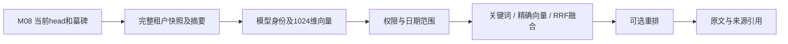

# 第9课：企业知识库与可验证的 RAG 检索

学习目标：从M08当前文档状态构建索引，比较关键词、向量和融合检索，检查权限与来源引用，亲自验证撤权、删除和重建。最后在Ubuntu接入真实BGE与pgvector，保存可复查的实验报告。本课的回答是**原文摘录**；M10再接入模型生成和Agent编排。

执行位置：Ubuntu服务器、包含本章文件的项目根目录。Windows只用于教材开发与离线回归。[本地验证记录](../validation/2026-10-22-m09.md)不能替代服务器验收。用户具体目录和解释器见仅本地保存的项目记忆；下文命令均从已确认的项目根目录执行。

## 1. 业务问题、原理与前置条件

“报价折扣超过10%，谁审批？”需要找对租户、角色、有效日期和文档版本。仅向量相似度高并不足以回答；拿到已撤销的制度会产生可追溯但错误的答案。



| 名词 | 本课做法 | 调整的影响 |
| --- | --- | --- |
| embedding | BGE-M3 CLS向量，L2归一化；维度1024 | 模型/权重/精度/设备身份不同要重新建索引，不混用 |
| keyword | 中文单字及bigram、英文数字token，TF-IDF式重合得分 | 是可解释基线，不是成熟中文分词或BM25 |
| dense | Python余弦精确排序；PostgreSQL用cosine距离 | 语义相近也可能无答案，不能保证拒答 |
| RRF | 两份排名按1/(60+rank)融合 | 排名融合，不直接相加不同尺度的原始分数 |
| k / candidates | 展示前5块 / 最多20候选，CLI可调 | 调大增加处理量和无关内容，不能保证质量提高 |
| reranker | 对已授权候选重新打分 | 增加成本，必须同题同候选配置比较 |
| source_digest | 当前整个租户head、墓碑、块的摘要 | 任一源状态变化，旧包失效；不是数字签名 |
| HNSW | 近似向量索引 | 可能少召回；请求HNSW不代表数据库实际用了它 |

前置：已读M08，能解释head/版本/墓碑；基础离线练习无需数据库、GPU或微调。数据库部分需要M01已初始化、`.env`存在且数据库健康。源码主线目前在开发分支；**先核对文件存在，不能只从旧main执行本章**。

## 2. 先跑不下载模型的最小实验

明确使用Python 3.12解释器建立新环境；若没有该解释器，回到M01实操辅导确认安装方案。不要把已有Python 3.14当作本项目已支持的环境，也不要替换系统Python。已有同名环境先核对用途。

```bash
test -f src/enterprise_ai/rag_eval.py
test -f data/samples/m09-retrieval.json
python3.12 --version
python3.12 -m venv .venv-rag
source .venv-rag/bin/activate
python -m pip install -e .
mkdir -p reports/local
python -m enterprise_ai.rag_eval demo --output reports/local/m09-offline-01
python -m unittest discover -s tests -p 'test_rag*.py' -v
```

预期demo退出0，`checks_passed=6`，六个布尔检查均为true；测试失败要保存完整输出，不继续宣称验收通过。demo只用标准库与Markdown；`FixtureEncoder`是字符哈希向量，**用于验证流水线，不能证明真实语义检索质量**。重跑改输出目录名，程序拒绝覆盖。

打开实验目录：`03-retrieval.json`保留三种检索及摘录；`04-changes.json`把crm-0001从sales改为employee且升v2，并删除crm-0002；`07-after.json`是重建后的结果；`summary.json`是检查总结。crm-0001不会从历史中抹去，但不应继续对sales可见。

```bash
python - <<'PY'
import json
from pathlib import Path
p = Path('reports/local/m09-offline-01')
s = json.loads((p/'summary.json').read_text())
assert s['checks_passed'] == 6 and s['stale_index_rejected']
after = json.loads((p/'07-after.json').read_text())
assert all(h['chunk']['document_id'] != 'crm-0001' for h in after['sales']['hits'])
assert all(h['chunk']['version'] == 2 for h in after['employee']['hits'])
print(s)
PY
```

刻意使用旧包连接更新后的state，预期退出1且不创建报告：

```bash
if python -m enterprise_ai.rag_eval eval \
  --index reports/local/m09-offline-01/02-index-v1.json \
  --state reports/local/m09-offline-01/state.sqlite --fixture \
  --output reports/local/m09-stale-must-not-exist.json; then
  echo '错误：旧索引不应成功'; exit 1
fi
test ! -e reports/local/m09-stale-must-not-exist.json
```

这一步仅在前面的demo成功、文件存在之后有意义。任意失败不自动等于正确失效；查看summary和原始状态，区分文件不存在、参数错误与旧索引。

## 3. 建独立基线，比较检索与指标

demo的state已经变更，不能继续套用v1题集做效果对比。另建未变更的30篇语料与state：

```bash
mkdir -p data/generated/m09-eval-01
python -m enterprise_ai.document_samples generate \
  --output data/generated/m09-eval-01/sources --count 30 --formats md
python -m enterprise_ai.document_pipeline ingest \
  --catalog data/generated/m09-eval-01/sources/catalog.json \
  --sources data/generated/m09-eval-01/sources \
  --state data/generated/m09-eval-01/state.sqlite \
  --report data/generated/m09-eval-01/ingest.json
python -m enterprise_ai.rag_index \
  --state data/generated/m09-eval-01/state.sqlite --tenant 1 --generation 1 \
  --fixture --output data/generated/m09-eval-01/fixture-t1.json
for mode in keyword dense hybrid; do
  python -m enterprise_ai.rag_eval eval \
    --index data/generated/m09-eval-01/fixture-t1.json \
    --state data/generated/m09-eval-01/state.sqlite --fixture --mode "$mode" \
    --output "reports/local/m09-fixture-t1-$mode.json" || exit 1
done
```

题集共有24题，每租户12题，覆盖CRM/HCM/SCM、错误角色、生效日前、无答案与跨租户请求。评估自动选择当前索引租户的12题；第二租户需要单独建`--tenant 2`索引并再评估。标签是文档级tenant+document+version，不是按某个chunk编号写答案。[数据卡](../data-cards/m09-retrieval.md)说明用途与限制。

Recall@k = 检索到的相关文档数/该题全部相关文档数；MRR@k = 第一个相关文档在去重文档排名中的倒数，再按有答案题平均。本课k限制的是**块**，然后对这k块去重；并非取全库前k篇文档。同一文档的重复块不能提高排名。错误有答案题记0并保留分母。无答案题另报告候选出现率、干净拒绝率和错误数；检索到无关候选不自动等于权限泄露，运行失败也不等于正确拒绝。

预期：报告kind明确标为fixture，errors为0；不预设Recall/MRR必须达到某分数。每题保留hits、chunk_ids和citations。抽查3题，把quote逐字与source_path指向的源文件核对，确认tenant/version/page/section匹配。引用有出处不意味着检索相关或结论正确。

## 4. Ubuntu加载真实模型

在同一个`.venv-rag`内安装候选依赖，勿改M06训练环境。先CPU，记录成功后才做GPU专题；本课依赖固定版本，Ubuntu组合尚待实际验收。

```bash
python -m pip install -r requirements/m09-rag.txt
python -m pip check
python -m pip freeze > reports/local/m09-environment.txt
df -h .
python - <<'PY'
import json
from pathlib import Path
from huggingface_hub import snapshot_download
c = json.loads(Path('configs/retrieval/m09-models.json').read_text())
common = ['config.json', 'tokenizer.json', 'tokenizer_config.json',
          'special_tokens_map.json', 'sentencepiece.bpe.model']
for key, weight, folder in [('embedding', 'pytorch_model.bin', 'models/m09-bge-m3'),
                            ('reranker', 'model.safetensors', 'models/m09-reranker')]:
    spec = c[key]
    snapshot_download(repo_id=spec['repo_id'], revision=spec['revision'],
                      local_dir=folder, allow_patterns=common+[weight])
    print(key, spec['revision'], folder)
PY
```

模型和依赖需数GB磁盘与下载流量；不能联网时停在离线实验，不写“真实模型通过”。上述下载只选本课加载器支持的单文件权重与tokenizer。BGE-M3使用固定revision的bin权重、受信官方来源与weights_only加载；不下载来源不明文件，不混入另一种权重布局。可先仅执行embedding那一项，重排是可选实验。官方文件及下载接口见文末。

```bash
python - <<'PY'
from enterprise_ai.rag_models import LocalEncoder
e = LocalEncoder('models/m09-bge-m3')
v = e.encode(['报价折扣超过10%需要审批。'])
assert len(v) == 1 and len(v[0]) == 1024
print(e.identity)
PY
python -m enterprise_ai.rag_index \
  --state data/generated/m09-eval-01/state.sqlite --tenant 1 --generation 1 \
  --model models/m09-bge-m3 --device cpu \
  --output data/generated/m09-eval-01/bge-t1.json
for mode in keyword dense hybrid; do
  python -m enterprise_ai.rag_eval eval \
    --index data/generated/m09-eval-01/bge-t1.json \
    --state data/generated/m09-eval-01/state.sqlite \
    --model models/m09-bge-m3 --mode "$mode" \
    --output "reports/local/m09-bge-t1-$mode.json" || exit 1
done
python -m enterprise_ai.rag_eval eval \
  --index data/generated/m09-eval-01/bge-t1.json \
  --state data/generated/m09-eval-01/state.sqlite \
  --model models/m09-bge-m3 --reranker models/m09-reranker --mode hybrid \
  --output reports/local/m09-bge-t1-hybrid-rerank.json
```

先确认小探针成功，再做索引与评估；若失败不要继续粘贴后续命令。模型身份包括设备、精度、依赖版本和文件摘要；建库/查询必须匹配。每次操作会复核权重摘要，CPU上较慢是本教学完整性策略的成本，不是吞吐基准。输入超1024 token明确拒绝，不能用静默截断掩盖切块问题；回M08调切块配置并升版本、重建。程序不记录总延迟，性能比较需额外测时。

## 5. 在已有M01数据库接入pgvector

先完成`.env`、数据库health和M01角色初始化。迁移只创建新rag_lab schema，不修改业务表。已有同名schema时拒绝重跑；不要为重跑而删库或删卷。初次执行失败请保留完整错误、检查事务与schema，再决定修复方案。

```bash
python -m enterprise_ai.db health
docker compose exec -T db sh -c \
  'psql -v ON_ERROR_STOP=1 -U "$POSTGRES_USER" -d "$POSTGRES_DB"' \
  < infra/postgres/migrations/020-m09-rag.sql
python -m enterprise_ai.rag_pg load \
  --index data/generated/m09-eval-01/bge-t1.json \
  --state data/generated/m09-eval-01/state.sqlite --collection m09-t1
python -m enterprise_ai.rag_pg verify \
  --index data/generated/m09-eval-01/bge-t1.json \
  --state data/generated/m09-eval-01/state.sqlite --collection m09-t1 \
  --model models/m09-bge-m3 --reader a --roles sales --query '报价折扣审批' \
  > reports/local/m09-pg-t1-verification.json
```

预期导入status=loaded；同代同包重导status=unchanged；fixture导入必须失败。verify保留Python精确结果、PostgreSQL精确结果、请求HNSW结果、实际EXPLAIN计划及top-k重合率。手工核对相同模型的分数和排名；float32精度与并列分数可导致排序差异。小语料可能选择Seq Scan，报告应如实保留，不能凭requested_method=hnsw就宣称用了索引。过滤可能降低近似召回；详见[pgvector官方过滤与迭代扫描说明](https://github.com/pgvector/pgvector/tree/v0.8.2#filtering)。

用真实数据库身份检查租户和角色，预期以下两个命令均非0退出（分别是错误租户与越权角色）：

```bash
if python -m enterprise_ai.rag_pg search \
  --index data/generated/m09-eval-01/bge-t1.json \
  --state data/generated/m09-eval-01/state.sqlite --collection m09-t1 \
  --model models/m09-bge-m3 --reader b --roles sales; then exit 1; fi
if python -m enterprise_ai.rag_pg search \
  --index data/generated/m09-eval-01/bge-t1.json \
  --state data/generated/m09-eval-01/state.sqlite --collection m09-t1 \
  --model models/m09-bge-m3 --reader a --roles hr; then exit 1; fi
```

这些失败只有在正确reader a/sales查询已成功的前提下才是有效负例。再建tenant2真实索引、导入独立collection，并用reader b验证成功：

```bash
python -m enterprise_ai.rag_index \
  --state data/generated/m09-eval-01/state.sqlite --tenant 2 --generation 1 \
  --model models/m09-bge-m3 --device cpu \
  --output data/generated/m09-eval-01/bge-t2.json
python -m enterprise_ai.rag_pg load \
  --index data/generated/m09-eval-01/bge-t2.json \
  --state data/generated/m09-eval-01/state.sqlite --collection m09-t2
python -m enterprise_ai.rag_pg verify \
  --index data/generated/m09-eval-01/bge-t2.json \
  --state data/generated/m09-eval-01/state.sqlite --collection m09-t2 \
  --model models/m09-bge-m3 --reader b --roles sales --query '报价折扣审批' \
  > reports/local/m09-pg-t2-verification.json
```

RLS从数据库session_user映射身份，不能靠模型传入roles授权；默认两个reader都只映射sales，hr/procurement不会因为CLI传入就获得权限。上面的CLI负例会在应用的check_reader检查处拒绝，**还不能验证数据库RLS本身**。两租户导入并成功查询后，直接以数据库读者身份执行无租户条件的SELECT，并检查角色映射不能修改：

```bash
python - <<'PY'
import psycopg
from enterprise_ai.settings import load_settings
from enterprise_ai.db import connect
settings = load_settings()
for reader, tenant in [('a', 1), ('b', 2)]:
    with connect(settings, reader) as conn:
        cols = conn.execute('SELECT collection_id,tenant_id FROM rag_lab.collections').fetchall()
        chunks = conn.execute('SELECT tenant_id,roles FROM rag_lab.chunks').fetchall()
        if not cols or not chunks:
            raise RuntimeError('先成功导入两租户并验证正常查询，空结果不能证明隔离')
        if any(t != tenant for _, t in cols) or any(t != tenant or 'sales' not in roles for t, roles in chunks):
            raise RuntimeError('无过滤SELECT出现越权行')
        forbidden = conn.execute('SELECT collection_id FROM rag_lab.collections WHERE tenant_id=%s', (3-tenant,)).fetchall()
        if forbidden:
            raise RuntimeError('数据库RLS没有隔离另一租户')
        try:
            # WHERE false确保即使错误授权也不更改任何角色映射。
            conn.execute('UPDATE rag_lab.reader_roles SET roles=roles WHERE false')
        except psycopg.errors.InsufficientPrivilege:
            pass
        else:
            raise RuntimeError('读者意外获得修改角色映射权限')
        print(reader, 'unfiltered SELECT/RLS and mapping write denial checked')
PY
```

预期两个reader均输出checked，未出现另一租户或非sales内容；任一异常均为验收失败。保留退出码及脱敏输出。真实数据库未执行前，不能把这些命令的预期结果填作实际成绩。

增量真实验收：另复制一套实验目录，按第2节的04-changes内容更新catalog与源文件摘要后调用ingest；旧包load/search必须拒绝；用generation=2和新输出路径重建，导入同collection，再核对撤权/删除结果。**不可**把demo中新state和第3节旧state混用。并发文档更新时需要上层停写或发布屏障，本课的查询前后摘要检查不构成跨服务原子撤权承诺。

## 6. 验收、故障与恢复

逐项填写[服务器验收手册](../runbooks/m09-rag-handoff.md)，不要只贴一张成功截图。

前面的最小实验只跑RAG定向测试。若要在新建的`.venv-rag`中执行全项目回归，还需安装M08真实格式测试的依赖，不能把预置环境的成功直接迁移过来：

```bash
python -m pip install -r requirements/m08-documents.txt
python -m pip check
python -m unittest discover -s tests -v > reports/local/m09-server-full-tests.txt 2>&1
```

检查最后一条命令退出码并打开完整日志；必须零失败才能记录该环境的全量通过，不能仅因日志文件存在就视为成功。

| 验收项 | 必须保留的证据 |
| --- | --- |
| 离线流程 | demo summary六项通过、定向测试日志、旧包失败和无输出文件 |
| 真实模型 | Python/依赖、官方revision、1024维探针、资产摘要、索引身份 |
| 质量 | 两租户逐题报告、三种检索与可选重排、失败题和拒绝题、3条人工引用核对 |
| 数据库 | 迁移退出码、正确reader成功、错误身份拒绝、同代导入保护、实际执行计划 |
| 增量 | 新版本/墓碑、旧包拒绝、新generation重建、旧权限和删除内容不可见 |

| 现象 | 排查与恢复 |
| --- | --- |
| ModuleNotFoundError | 确认包含本章的分支、当前目录和激活的环境；重做editable安装 |
| stale index | 正常保护；检查当前M08来源，升generation生成新文件，不绕过校验 |
| FileExistsError | 产物拒绝覆盖；换实验编号，保留旧证据 |
| 模型identity不匹配 | 对照设备/依赖/资产摘要；使用同环境重建，不手改JSON摘要 |
| DB操作只显示异常类型 | CLI主动不打印连接细节；用本地受控终端查看psql/数据库日志并脱敏，不把.env上传 |
| schema已存在 | 先核对迁移是否成功；不删schema、业务库或卷“重试” |
| 无答案题仍有候选 | 区分相关性、权限与拒答；分析逐题原文，不把top-k当可信答案 |
| CUDA/显存失败 | 本课先CPU；保留原环境，另做GPU兼容探针，不升级系统驱动来凑一次实验 |

## 7. 练习与参考答案

1. 同一制度的5个块占满top5，另一个相关制度排第6块，标签有2篇，Recall@5是多少？
2. 将crm-0001撤去sales后，仅追加employee的新向量，为什么不足？
3. HNSW请求返回Seq Scan且top-k一致，能否称“近似索引已验证”？
4. 12题中8道有答案，1道有答案题超时，其余7道全命中，平均Recall是多少？

参考：1）1/2；块重复不能增加文档命中。2）旧块仍可能可见，必须切换当前head、失效旧包并重建。3）不能，需要实际计划证据；结果一致只说明这一次结果相同。4）7/8；失败题不能删掉。再说明超时原因和逐题输出，而非只报分数。

## 8. 官方资料

- [BGE-M3固定模型文件](https://huggingface.co/BAAI/bge-m3/tree/5617a9f61b028005a4858fdac845db406aefb181)
- [重排模型固定文件](https://huggingface.co/BAAI/bge-reranker-v2-m3/tree/953dc6f6f85a1b2dbfca4c34a2796e7dde08d41e)
- [Hugging Face下载、revision与local_dir](https://huggingface.co/docs/huggingface_hub/guides/download)
- [pgvector 0.8.2](https://github.com/pgvector/pgvector/tree/v0.8.2)

本课先把检索与可追溯证据做扎实，下一课再把数据库和检索包装为LangGraph工具。
