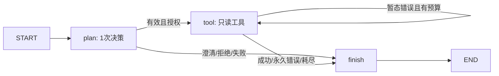

# 第10课：用 LangGraph 串起模型决策、数据库工具与知识检索

本课目标：用真实`StateGraph`理解state、node、edge、条件路由、有限重试和节点更新流。模型只提出一个受检计划，确定性代码校验参数、身份、预算并执行只读工具，最后展示实际数据或引用。它是单次规划的工作流入门；多步业务、人审、持久化与写入在M11，生产认证在M12。

执行位置：Ubuntu、包含本章文件的仓库根目录。M09稳定学习分支不因本章开发而改变；本章分支为`codex/m10-langgraph-basics`。先按[起步手册](../runbooks/server-start.md)检查并保留本地修改；工作区干净且准备学习本章时，再取得M10分支：

```bash
git remote set-branches --add origin codex/m10-langgraph-basics
git fetch origin \
  refs/heads/codex/m10-langgraph-basics:refs/remotes/origin/codex/m10-langgraph-basics
if git show-ref --verify --quiet refs/heads/codex/m10-langgraph-basics; then
  git switch codex/m10-langgraph-basics
else
  git switch --track origin/codex/m10-langgraph-basics
fi
git merge --ff-only origin/codex/m10-langgraph-basics
git rev-parse HEAD
cat VERSION
test -f src/enterprise_ai/agent_cli.py
```

预期本章批次0.1.7.0，不使用M09起步手册里的0.1.6.0版本断言；不快进或有覆盖冲突就停止，不重置仓库。

## 1. 业务问题与图

同样是“客户1有多少订单”和“报价审批制度”，前者需要确定性SQL，后者需要文档证据。把所有文本塞给模型，无法保证权限、数据时效和数值正确。本章让模型选择受控工具，工具自己读取事实。



| 概念 | 本课实现 | 要亲自观察的点 |
| --- | --- | --- |
| State | request/status/plan/calls/result/answer/events | 节点返回增量，events用追加reducer |
| Node | plan、tool、finish | 普通函数可以包含模型或确定性代码 |
| 条件边 | 按status分支 | 失败和澄清不会执行工具 |
| 工具契约 | customer/leave/inventory/knowledge | 不接受SQL、tenant、roles或employee参数 |
| updates流 | 每个节点完成后的增量 | 不是模型逐token输出，也不是持久化 |
| retry | 默认最多2次工具尝试 | 只读暂态错误可重试，权限/参数/旧索引不可重试 |
| 预算 | 输入500字符、结果64KiB、软时限60秒 | 调用前后检查不能强制中止已阻塞I/O |

可信Principal在图外由CLI绑定；本课CLI操作者是可信的，它不等于服务端身份认证。数据库身份还要与reader会话映射一致；模型不能重写它。休假查询绑定数据库本人，年份来自可信`--as-of`（教学默认2026-10-22）。正式产品应由服务端身份和业务时间提供，不能让用户任意自报权限。

## 2. 新建独立环境，先不接模型和数据库

确认Python3.12可用；不要替换系统Python，不在训练环境安装本章依赖。已有同名环境先核对用途。

```bash
test -f src/enterprise_ai/agent_cli.py
python3.12 -m venv .venv-agent
source .venv-agent/bin/activate
python -m pip install -e .
python -m pip install -r requirements/m10-agent.txt
python -m pip check
mkdir -p reports/local
python -m pip freeze > reports/local/m10-environment.txt
python -m enterprise_ai.agent_cli --fixture --stream \
  --request '报价审批制度' --output reports/local/m10-normal-01
```

核心固定为LangGraph1.0.2及requirements中配套版本，是本课程已运行的组合，不声称最新。Windows开发验证把依赖放在被忽略的独立测试目录，未改全局Python或启动服务；Ubuntu安装仍需你的实际证据。依赖可能发出`allowed_objects`未来默认值变化的警告；本章未启用checkpoint/cache，不反序列化持久化状态，M11再显式处理序列化配置。

预期看到plan→tool→finish的3个节点更新，最终status=ok、kind=`synthetic-fixture-not-live-agent`。每个新输出目录内生成30篇Markdown、M08状态、M09哈希索引、`events.json`、`state.json`与`summary.json`。知识检索实际走M09管线；业务表数据与规划器是明确的合成替身，不代表真实模型或数据库成绩。

```bash
python - <<'PY'
import json
from pathlib import Path
p = Path('reports/local/m10-normal-01')
s = json.loads((p/'state.json').read_text())
events = json.loads((p/'events.json').read_text())
assert s['status'] == 'ok' and s['calls'] == 1
assert [next(iter(e)) for e in events] == ['plan', 'tool', 'finish']
assert s['result']['answer']['citations']
print(s['answer'])
PY
```

不要在同一输出目录重跑；拒绝覆盖是证据保护，改用新的实验编号。直接查看源代码的`FixturePlanner`、`decision`、`Runner`和`build_graph`，对照这3个节点的状态变化。

## 3. 做分支、故障与边界实验

```bash
python -m enterprise_ai.agent_cli --fixture --stream \
  --request '客户' --output reports/local/m10-clarify-01
python -m enterprise_ai.agent_cli --fixture --stream \
  --request '客户1订单' --output reports/local/m10-customer-01
python -m enterprise_ai.agent_cli --fixture --roles employee \
  --request '我的休假' --output reports/local/m10-leave-01
python -m enterprise_ai.agent_cli --fixture --roles procurement \
  --request '商品1库存' --output reports/local/m10-stock-01
python -m enterprise_ai.agent_cli --fixture --stream --scenario retry \
  --output reports/local/m10-retry-01
```

预期：客户无编号→clarify且calls=0；客户1→合成金额字符串；休假只显示绑定本人；商品1→合成库存。retry实验第一次工具失败、第二次成功，events中tool出现两次，calls=2。合成规则不能证明模型意图识别质量。

以下实验应退出1，并保留安全的失败状态；先确认normal实验成功，不能把环境缺依赖造成的失败当作安全边界通过：

```bash
for scenario in permanent invalid-plan budget; do
  if python -m enterprise_ai.agent_cli --fixture --scenario "$scenario" \
    --output "reports/local/m10-$scenario-01"; then
    echo "错误：$scenario 应当失败"; exit 1
  fi
done
python -m unittest discover -s tests -p 'test_agent*.py' -v
```

逐个检查summary：permanent→failed且不重试；invalid-plan→rejected且不调用SQL；budget→budget且不保存超时返回的result。预算实验使用可控教学时钟，不以真实等待一分钟演示。软件软时限不是强制取消：Ollama socket最多30秒、数据库statement_timeout为5秒，整个工作流还在调用前后检查预算；网络底层不同阶段仍不等同绝对墙钟上限。

## 4. 接入现有 Ollama 与真实只读数据库

前置：M01/M02的`.env`、数据库及教学数据已验收，M04已确认模型的确切标签、来源和本地调用能力。本章不下载生成模型，也不根据口述标签猜测其实际架构。

```bash
python -m enterprise_ai.db health
python -m enterprise_ai.db demo --reader a
read -r -p '输入已在M04核实的Ollama完整模型标签: ' OLLAMA_MODEL
python -m enterprise_ai.agent_cli --live --stream --model "$OLLAMA_MODEL" \
  --reader a --roles sales --request '查询客户1的订单概况' \
  --output reports/local/m10-live-customer-01
python -m enterprise_ai.agent_cli --live --stream --model "$OLLAMA_MODEL" \
  --reader a --roles employee --request '查询我的休假余额' \
  --output reports/local/m10-live-leave-01
```

规划器调用既有loopback-only Ollama客户端，固定JSON计划、temperature=0、生成预算192 token并设置think=false。服务器若不支持该模式，保存失败结果，回M04核对能力后调整适配并补测试；不能把模型协议错误当正确拒答。模型原始任意JSON会在runtime再次严格校验，不能自行增加授权字段或切换用户。

数据库查询使用固定参数SQL、reader登录、只读事务、最多50行；核对当前tenant与employee，再读取数据。模型只决定customer_id/product_id，leave不接收employee_id。结果金额保留字符串，避免浮点近似。本课直接展示工具数据，不让另一次模型调用编造业务结论。

预期kind=`live-model-readonly-workflow`，summary保存模型digest与框架版本；拿state结果与M02相同查询逐字段对照。若没有对应记录，insufficient是允许结果，但不能写成业务准确率通过。用reader b重复查询，确认只见另一租户；角色边界负例和审批/写入不属于当前SQL工具授权能力。

## 5. 同一图接入真实知识检索

使用M09已验收的当前BGE索引、M08 state和相同资产/环境身份。本章独立环境若尚无embedding依赖，安装M09候选依赖后执行pip check，并重新核对模型身份；权重目录可复用，不必重复下载。

```bash
python -m pip install -r requirements/m09-rag.txt
python -m pip check
python -m enterprise_ai.agent_cli --live --stream --model "$OLLAMA_MODEL" \
  --reader a --roles sales --request '折扣超过10%的报价如何审批' \
  --index data/generated/m09-eval-01/bge-t1.json \
  --state data/generated/m09-eval-01/state.sqlite \
  --embedding models/m09-bge-m3 \
  --output reports/local/m10-live-rag-01
```

预期模型选择knowledge，结果含M09的原文与引用。若模型选择其他工具或无证据，保留其计划和失败案例，不手改成绩。该路径采用M09 Python检索基线，不冒充pgvector/HNSW调用。用另一租户的index配reader a应失败；来源变更后旧包也应失败且不重试。批量权限/删除实验仍使用M09，不为本章绕过freshness。

## 6. 验证、恢复与练习

完整回归还需M08格式测试依赖。安装、模型、DB的实际结果填写[实操手册](../runbooks/m10-agent-handoff.md)，本地证据见[验证记录](../validation/2026-10-22-m10.md)。

```bash
python -m pip install -r requirements/m08-documents.txt
python -m pip check
python -m unittest discover -s tests -v > reports/local/m10-full-tests.txt 2>&1
```

检查退出码与完整日志，不能只看到文件就声称通过。缺langgraph时测试会明确失败，不用自写状态机替代框架。发生错误时对照：

| 现象 | 恢复 |
| --- | --- |
| ModuleNotFoundError | 核对分支、解释器、已激活环境与requirements安装 |
| FileExistsError | 换新实验编号，保留已有结果 |
| rejected | 对照plan的字段与角色；不放宽SQL或授权白名单迎合模型 |
| planning_failed | 回M04核对模型与协议；原始HTTP诊断保留本地并脱敏 |
| failed | 常见为永久工具错误、旧索引、输出过大或身份不匹配；不盲目增加重试 |
| unavailable | 暂态错误已耗尽尝试，核对服务健康与网络 |
| budget | 减小工作量或查慢调用；不要把软预算误称硬超时 |
| insufficient | 当前工具无结果或无证据，补信息并核对范围 |

练习：1）为什么employee_id不能作为模型参数？2）如果只读工具超时后自动重试，为什么M11写工具不能照搬？3）updates有三条是否代表生成了三个token？4）删掉来源后增大retry次数能修复旧索引吗？

参考：1）身份由可信上下文与数据库会话绑定。2）写操作有副作用，必须先定义幂等与事务。3）不是，三条是节点增量。4）不能，旧包是永久失效，需重建而非重试。

官方资料：[Quickstart](https://docs.langchain.com/oss/python/langgraph/quickstart)、[Graph API](https://docs.langchain.com/oss/python/langgraph/graph-api)、[流式输出](https://docs.langchain.com/oss/python/langgraph/streaming)。本章真实框架运行不等于生产部署，下一章加入业务案例、审批与持久化。
