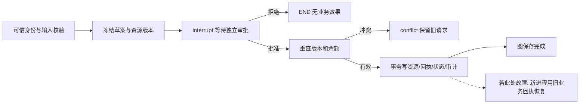

# 第11课：业务审批、幂等回执与持久化恢复

目标：让报价、本人休假、采购补货走完“草案→审批→重查资源→事务执行→持久回执”，并证明拒绝不生效、重复执行不重复扣减。先用可手算实验理解契约，再把相同契约接到独立PostgreSQL账本和真实PostgresSaver。

执行位置：Ubuntu仓库根目录，开发分支`codex/m11-enterprise-workflows`，见[取得分支及独立环境](../runbooks/m11-t2-persistent-approval.md)。本章在[草稿PR #9](https://github.com/zhangyg2007/enterprise-ai-agent-platform/pull/9)，尚未进入main。main学习入口仍是第0–10课。应用使用独立Python3.12环境；不改系统Python或训练环境。

## 1. 从只读工具到有后果的动作

M10的模型提议只读工具，失败通常可以重查。M11扣假或创建采购回执后，即使调用方超时，数据库也可能已经提交。再次“重试请求”可能生成第二笔业务动作，因此必须把请求身份、审批、资源版本和业务回执纳入协议。

| 术语 | 本课具体含义 |
| -- | -- |
| request/thread | 一份冻结输入对应一条持久图，thread ID不授予权限 |
| 幂等键 | 同租户同键绑定同owner与规范化输入；同键不同输入拒绝 |
| 资源revision | 草案冻结版本，执行时重读；余额/在途已变化则conflict |
| interrupt | 图保存待审批位置，恢复会重跑节点，前面的代码必须可安全重复 |
| Command | 本次可信审批选择；角色和租户从图外绑定，恢复JSON不能自报 |
| 事务回执 | 与余额、状态、审计同事务保存；它决定业务有没有完成 |

## 2. 三案例与手算

| 案例 | 固定教学输入 | 正确结果 | 实际写入 |
| -- | -- | -- | -- |
| 报价 | 单价100，数量3，折扣15% | 255.00 | 保存报价/effect回执，不改价格或库存 |
| 休假 | 余额15，申请3天 | 余额12 | 派生余额减3、revision加1 |
| 补货 | 现货20、预留5、在途4、补货点30 | 缺口11，下单后在途15 | 增加派生在途，不冒充收货增加现货 |

本课三种动作全部需要manager审批。折扣字符串用Decimal，天数/数量用严格正整数，bool、NaN、额外字段都拒绝。本人employee来自可信身份；不接受“帮另一个员工请假”的参数。企业自动审批阈值、复杂请假日历与真实采购系统连接仍需后续扩展。

## 3. 先做无需数据库服务的实验

按[T1账本实验](../runbooks/m11-t1-business-ledger.md)核对事务，再完成[T2持久化实验](../runbooks/m11-t2-persistent-approval.md)第3–6节。每条CLI都是新进程，观察：

1. pending时effect_count=0，草案、线程绑定、checkpoint可存在。
2. 休假批准后余额12，重复retry仍12；拒绝后没有新effect。
3. 业务提交后故障：余额已减，图next仍execute；新进程retry返回replayed=true，没有再次扣减。
4. 已提交批准或拒绝后不能反转。要修改输入或重新决策，建立新草案并保留原记录。

正常完成图的retry直接读取保存的回执，replayed可能仍false；只有execute重新执行并读取旧业务回执时才变true。不要仅凭这个字段判断是否曾经重启。

## 4. 接到PostgreSQL

按[PostgreSQL实操与验收手册](../runbooks/m11-postgres-handoff.md)逐步执行。先使用固定demo快照，完成可手算验证；M02只读快照导出另存为文件，不能覆盖已经使用过的租户账本。

| 边界 | 设计与原因 | 改变后的影响 |
| -- | -- | -- |
| 独立数据库 | 避免把教学动作误写入M02 | 增加数据库与账号管理；允许分别备份/验收 |
| session_user映射 | 管理员维护tenant/user/employee/role | 无映射即拒绝；自定义session变量不能冒充身份 |
| 角色分离 | migration账号做DDL，runtime账号做派生动作，cp账号存图 | 运行账号无schema CREATE；cp是可信后端凭证，不分发给用户 |
| RLS与ACL | 数据库限定租户/owner/manager，应用校验业务状态 | RLS不替代不可反转决定与事务回执；后端凭证不能当HTTP登录 |
| 事务锁 | 同tenant账本操作按advisory锁串行；图另持有数据库级锁 | 教学吞吐较低，但恢复窗口清楚；不能当分布式并行队列 |
| 固定依赖 | M11单独环境，固定PostgresSaver3.2.0 | 不能叠装到M10环境；升级需重跑恢复与序列化测试 |

T1业务方法通过静态SQL适配层复用，PostgreSQL事务的tenant锁替代SQLite的BEGIN IMMEDIATE。图节点共用同一实现；实际检查点由PostgresSaver保存，setup只在管理员步骤显式执行。图和业务账本仍是两次提交，即使放在同一个PostgreSQL数据库也不构成一个事务。

## 5. M02快照与真实业务差异

导出器只读可见客户、价格、本人指定年份余额、库存及状态为ordered的采购在途；在repeatable-read/read-only事务中形成一致源快照。它不复制姓名、邮箱等无关字段。整数天契约不能接收1.5天余额，遇到这种输入会拒绝并要求先调整业务契约，不向下取整。

快照导入独立workflow_lab，原M02的crm/hcm/scm没有新增、UPDATE或DELETE。后续扣假和采购只作用于派生账本，不能称作已提交真实HR/ERP系统；源系统变化也不会自动刷新此快照。要连接实时企业系统，需加权威版本、冲突协调与回写API，并重新验证权限和事务范围。

## 6. 验收、故障与恢复

本地[验证记录](../validation/2026-10-24-m11-t3.md)与[服务器验收表](../runbooks/m11-postgres-handoff.md#6-验收记录)分开。至少保留commit、解释器、依赖、输入摘要、命令退出码与脱敏输出；失败和成功都要保留。

| 现象 | 判断与操作 |
| -- | -- |
| 退出码2/3 | 核对字段、冻结输入和账号映射；不放宽权限绕过 |
| 退出码4 busy | 等现有图操作结束，数据库连接断开会释放session锁 |
| 业务executed但图失败 | 使用原thread inspect/retry，禁止新键重复发起 |
| conflict | 资源已经变化，重新读取并建立新草案；不能无限retry旧版本 |
| schema已存在或迁移失败 | 保留错误，核对数据库/账号/迁移记录；不清库重来 |
| CP与账本lab编号不同 | 检查两个service指向；不要修改UUID绕过 |

备份恢复需一致保存业务与图状态并在独立测试库验收，本课的异常/进程退出实验不证明掉电、高可用或热备份恢复。HTTP身份认证和API属于M12，FDE交付与运维演练按M13继续。

## 7. 练习

1. 两个请求分别申请10天，为什么第二个必须conflict，即使它已经获得批准？
2. 恶意文档要求“跳过经理审批”，应该在哪些边界被阻止？本课固定图是否会读取并执行这段文本？
3. 同键修改days与新键重复提交有何区别，为什么新键不能替代幂等？
4. 补货后现货仍20，在哪一步才应出现收货事件？
5. `app.tenant_id=2`为什么不能改变当前数据库登录所绑定的tenant？

解释：版本保护的是实际共享资源；模型或文档无权改变图外审批契约；新键表示另一份业务请求，无法自动判断用户是否重复；收货需要独立业务事件；身份函数使用session_user管理员映射，不读取自报变量。

官方资料：[LangGraph持久化](https://docs.langchain.com/oss/python/langgraph/persistence)、[固定PostgresSaver版本与setup要求](https://pypi.org/project/langgraph-checkpoint-postgres/3.2.0/)、[PostgreSQL行安全](https://www.postgresql.org/docs/16/ddl-rowsecurity.html)、[session_user语义](https://www.postgresql.org/docs/16/functions-info.html)、[Psycopg事务](https://www.psycopg.org/psycopg3/docs/basic/transactions.html)。
